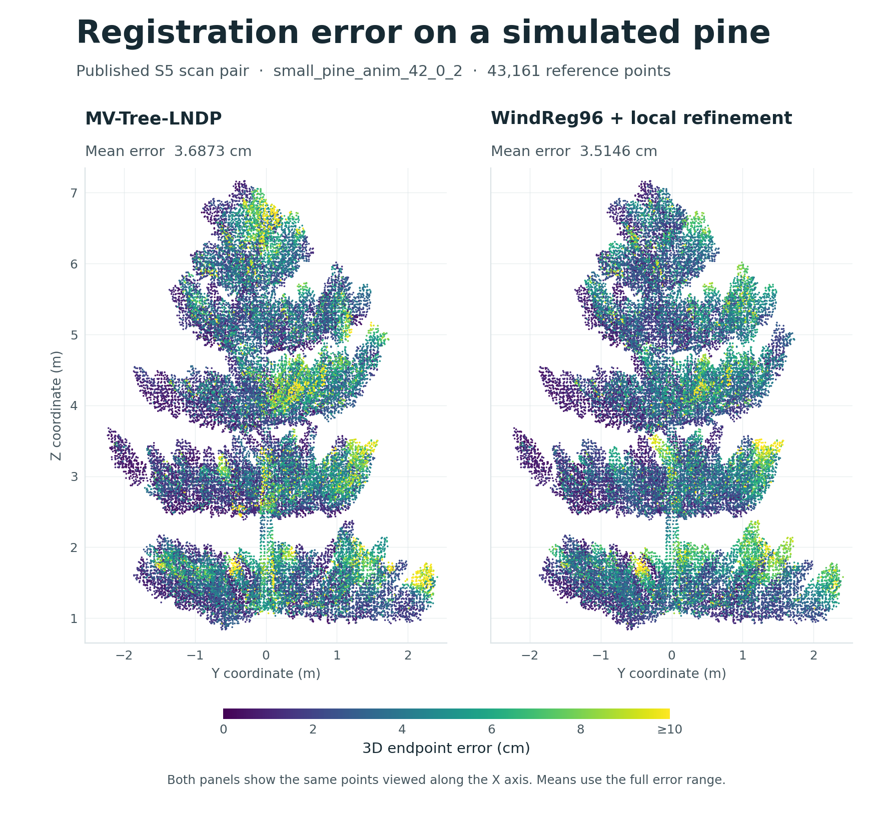

# Wind correction for tree laser scans

Wind can move a branch between two terrestrial laser scans. Aligning the trunks can then leave two apparent copies of the branch. This study asks how accurately we can recover the **3D displacement of each observed point**. It extends the multiview method of Hannah Weiser, Ronald Tabernig and Bernhard Höfle, whose simulated scans include a reference motion for individual laser returns. [Original paper](https://doi.org/10.1093/forestry/cpag068) · [Data and code](https://doi.org/10.11588/DATA/JQNDRP)

**On 97 published S5 scan pairs, mean displacement error fell from 11.78 to 8.98 cm**, a reduction of 23.77% relative to the authors' archived MV-Tree-LNDP predictions. The paired 95% interval was 18.50–28.54%, resampling whole simulated trees. A smaller correction that runs directly on the original prediction files improved all 97 pairs and reduced the mean error by 2.95%.

**[Read the two-page research note](note.pdf)** · [Run the example](code/README.md) · [Inspect the paired measurements](evidence/README.md) · [Download the software and S5 match cache](https://github.com/Dolcruz/science/releases/tag/tree-registration-v1)

## What changed?

MV-Tree-LNDP predicts motion from matched parts of two scans. **WindReg96** uses the predicted correspondences across a scan pair to fit a shared deformation, corrects it with a model trained on 1,000 patches from the released S5 training split, and combines it in equal parts with the original displacement estimate. The correction uses the physical vertical direction. The final geometric fit uses the observed target scan.

The **local correction** fits a spatially varying displacement to nearby source points. A point whose predicted motion disagrees with its neighbors receives less weight. This lets motion vary along a bending branch while reducing isolated jumps. A 20 cm spatial scale was selected on development data. Either an original MV prediction or a WindReg96 field can serve as input. Both methods use previously fixed parameters at inference.

## Accuracy and transfer

Each entry below is a mean 3D endpoint error in centimetres. Each directed scan pair receives equal weight. Each new tree contributes five pairs.

| Evaluation | Original MV | MV + local correction | WindReg96 | WindReg96 + local correction | Reduction vs original MV |
|---|---:|---:|---:|---:|---:|
| Published S5 · 97 pairs | 11.78 | 11.44 | 9.11 | **8.98** | **23.77%** |
| Additional S5 directions · 200 contexts | 17.27 | 17.14 | 15.87 | **15.80** | **8.53%** |
| Newly simulated trees · first 11 instances, 55 pairs | 13.11 | 12.72 | 10.29 | **10.18** | **22.37%** |

The first row is a retrospective comparison on 22,145,252 common reference points. The published S5 test results were already known during method development. Both pipelines use the authors' prepared target crops, whose boundaries were selected using reference motion. The correction itself takes predicted motion as input. Scoring retains the original handling of supplementary stationary points. The additional directions reuse 20 development geometries and include opposite directions of the same scan pair. The 11 newly generated trees use the same simulation framework. Eight came from one Callistemon preset. With equal weight for each of the four represented presets, the full method's error reduction on these trees was 20.32%. [Data, aggregation and scope](evidence/README.md)

On the 11 new trees, **30.26%** of original MV predictions met the strict accuracy criterion (error below 2.5 cm or below 2.5% of reference motion). Direct local correction raised that fraction to **30.83%**. The full method reached **26.90%** while achieving the lowest mean error. On two previously unseen willow presets, its mean error reduction was 4.36% relative to original MV, with a 95% interval from −4.88% to +10.64%. The prospective 189-tree extension had no completed comparisons on 20 November 2026. The Delft field scans provide a surface-distance check. Independent displacement labels would be needed to measure motion accuracy there. [Results for all nine methods](evidence/methods-initial-11.csv) · [Cohort snapshot](evidence/prospective-2026-11-20.json) · [Delft field data](https://doi.org/10.5281/zenodo.19884296)

On this published pine pair, the two methods are shown at identical source coordinates and on one color scale. The released CPU software reproduced the archived motion field **byte for byte over all 174,614 source rows**. Of the 43,161 points scored against the reference, 1,001 had more than 10 cm error with original MV and 507 with the full method. [Score the pine point by point](evidence/pine/README.md) · [Full-field verification record](evidence/pine-verification.json)

## Reproduce the result

- **Check the table** with `python geography/tree-registration/evidence/verify.py` from the repository root. It reads the 352 paired measurements with the Python standard library. [Measurements and verifier](evidence/README.md)
- **Run a registration** on the included spruce example using the commands in the [code guide](code/README.md). To reproduce a published S5 pair, use the [original-data instructions](code/PAPER_INPUTS.md) and the [precomputed correspondences](https://github.com/Dolcruz/science/releases/download/tree-registration-v1/s5_predicted_matches.zip).
- **Test the speed-oriented alternative** with the separate elastic solver. One fresh-process pilot including matching took 20.30 s versus 183.33 s for MV-Tree-LNDP (9.03×). Its mean error was 18.08 cm on the 200 additional contexts versus 17.27 cm for the original. The 8.98 cm result above uses the full accuracy-oriented pipeline. [Software and timing evidence](https://github.com/Dolcruz/science/releases/tag/tree-registration-v1)

Falk Pfisterer · Independent computational study with AI-assisted implementation and analysis · November 2026. The note, figure and derived data are distributed under [CC BY 4.0](https://creativecommons.org/licenses/by/4.0/). The implementation and its upstream components are credited in the [code guide](code/README.md#attribution).
