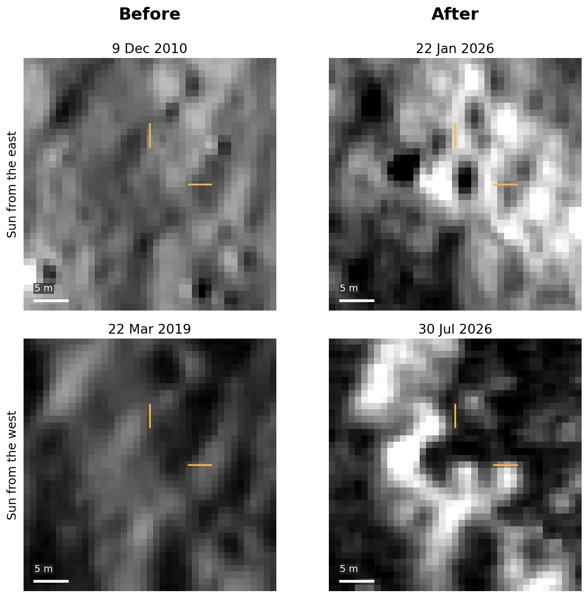

# A candidate depression northwest of McGetchin crater

A roughly 5 m hollow appears in repeated LROC observations at **1.36151° N, 67.16426° E**, 442 m northwest of McGetchin. The wall shading changed under matched eastern and western sunlight. Three December 2025 stereo pairings place the center 0.37–0.51 m below its immediate surroundings at a seven-pixel matching scale.

**The origin remains open.** Excavation by a secondary impact and uneven deposition around older relief are both consistent with the images. The three stereo pairings share exposures, the western flank can cast a shadow and the height contrast changes sign at larger matching scales. There is no pre-impact elevation measurement at comparable resolution. The published date of the primary impact is narrower than the imaging interval for the small hollow.

**[Read the illustrated report (PDF)](lunar-surface-changes.pdf)** · [Editable LaTeX source](lunar-surface-changes.tex) · [Image and catalog credits](DATA-SOURCES.md)



Each panel covers the same 39 m square, north up. Orange ticks mark the candidate. Within each row, the before and after views use the same normalized grayscale. A separate brightening at 6.103° S, 276.992° E was present 73 days before the 25 May 2023 NELIOTA flash, ruling out that flash as its cause.

## Evidence and verification

From the repository root, install NumPy and run the command below. It verifies the distributed file hashes, measures the opposing wall contrasts and local stereo heights from registered pixels, checks the western-flank height range, and recomputes the independent brightening and its chronology. The field directories document the original observations and full-image workflows. The McGetchin analysis used up to four OpenCV and four BLAS threads per process.

```sh
python -m pip install numpy
python physics/astronomy/lunar-surface-changes/verify.py
```

This was an exploratory archive search without preregistration. The McGetchin search tested seven spatial scales and yielded 85 distinct locations. Six reached the follow-up score of 3 under opposite lighting. The follow-up shares some images with the initial screen. Neither score gives a discovery probability. Detection completeness remains uncalibrated.

On 20 November 2026 the catalog and literature search covered the discovery paper, all four supplementary figures, the released imagery and terrain models, published LROC change tables and subsequent citations. The site lies inside previously published imagery. No public identification of a secondary crater at this position was found in those sources. First-identification priority remains open. [Literature search](catalog/literature.md) · [Nearest catalog entries](catalog/nearest.csv)

Falk Pfisterer selected the research question. OpenAI Codex agents selected observations, registered and analyzed the images, checked competing interpretations, and wrote the code and report. The satellite observations, primary discovery, and published catalogs are the work of the credited instrument and research teams. [Data sources and reuse](DATA-SOURCES.md)

## Field analyses

| Directory | Scientific content |
|---|---|
| [mcgetchin](mcgetchin/) | Original-product identifiers and pixel coordinates, area and site measurements, stereo and map comparison |
| [independent-relief](independent-relief/) | Far-field height and shadow-ray tests of the western ejecta ridge |
| [catalog](catalog/) | Catalog identifiers, original source hashes, nearest coordinate-bearing entries for each site |
| [neliota](neliota/) | Strip surveys, usable-pixel masks, candidate tables, registered cutouts and aperture measurements in the fields of flashes 281 and 283 |
| [nel283-shape](nel283-shape/) | Early and late appearances of the western-limb bright deposit, control craters and relief tests |
| [flash-association](flash-association/) | Temporal and positional checks against flash and spacecraft records |
| [flash](flash/) | Surface changes around the March 2013 Mare Imbrium crater |
| [reconstructed](reconstructed/) | The N13-field marking, image sequence and independent Kaguya and LROC positions |

To render the four McGetchin panels again, run `python walls.py` here. The supplied 47 × 47 pixel chips come from the registered products using map indices 206 through 252 eastward and 337 through 383 southward, both inclusive. The common 1 m grid is north-up. Each image is normalized by the median brightness 12–22 m from the target. The display uses a shared linear grayscale across each pair. The data in the other folders can be reproduced independently. The editable LaTeX report can be compiled with `pdflatex lunar-surface-changes.tex`.

Calibrated image-strip data are available from the source URLs. Their sizes greatly exceed those of the report and candidate cutouts. A flag in the search tables designates a brightness or shading change selected for examination. Individual field comparisons have different sensitivity and overlap.
