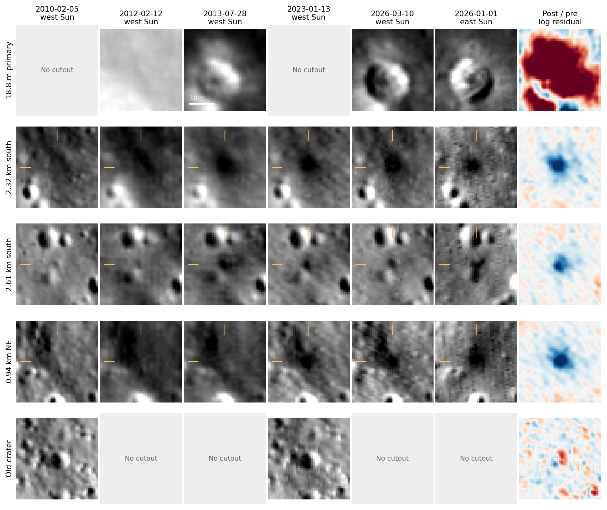

# Small surface changes near the 17 March 2013 Mare Imbrium impact

Two compact patches south of the 18.8 m March 2013 crater darkened between 2012 and July 2013. A third patch 0.94 km northeast of the crater darkened years later, between 23 February 2016 and 10 March 2017. The comparison photographs show changes in reflectance. None of the three sites shows a distinct new cavity with a rim and opposing interior walls.



North is up, east is right, and each panel spans 34.3 m. The orange marginal ticks mark the aperture center. Each natural image has its own linear grayscale stretch. The right column shows fitted log reflectance residuals on a common scale from −0.13 (blue) to +0.13 (red). It uses the sharp 2010–2023 images wherever available and 2012–2013 at the primary. The top row shows the published crater. The bottom row shows an older crater that triggered the change detector.

## Site measurements

| Site relative to the primary | Approximate planetocentric location (°N, °E) | 2012 Feb–2013 Jul | 2010 Feb–2023 Jan | 2023 Jan–2024 May |
|---|---|---:|---:|---:|
| 2.61 km south-southeast | 20.6283, 335.6831 | −6.09% | −9.15% | −0.36% |
| 2.32 km south-southeast | 20.6390, 335.6877 | −8.88% | −10.86% | −1.41% |
| 0.94 km northeast | 20.7382, 335.6897 | +0.56% | −12.09% | +0.86% |

The aperture radius is 3 m. The February 2010 and January 2023 acquisitions use the same NAC left detector at 0.78 and 0.76 m per sample with solar incidences of 54.74° and 53.40°. None of 40 disjoint nearby control apertures at each site darkened as much in that pair. The 2024 late epoch provides a separate detector and acquisition. The largest 2023–2024 control brightening at the northeast site was +0.83%, close to its +0.86% measurement. Controls describe local variability at sites selected in a larger search. They do not yield a survey-wide false-positive probability.

At both southern sites an independent March 2012–August 2013 pair at low solar incidence gives losses of 4.04% and 5.60% respectively. Both show stronger contrast at high incidence in the separate January 2012–July 2022 pair (11.61% and 13.61%). The timing admits association with the March 2013 impact. The images do not date either change to that day. A dark central patch persists under east and west illumination in 2026, while shadows in adjacent old craters change sides.

At the northeast site, the early 2013–February 2016 comparison gives +0.27%, within local controls. That February image compared with two later acquisitions in June and November 2020 yields losses of 6.42% and 6.43%. An east-lit September 2015–March 2017 pair gives −11.01%, and March 2017–January 2026 gives −0.56%, within controls. The January 2017 acquisition shows roughly 2% darkening under nearly overhead illumination, where surface contrast is weak. The February 2016–March 2017 bracket uses the stronger comparisons. The northeast change therefore occurred years after the March 2013 impact.

## Search and prior observations

Forty 896 m square tiles were tested around the known primary. Valid coverage was 26.060 km² for the principal February 2012–August 2022 pair. Coverage in the February 2012–July 2013 and January 2012–July 2022 pairs was 20.582 and 16.366 km² respectively. These figures count valid pixels in each pair, including pixels outside the principal pair. All three pairs overlap on 5.716 km². Across the field, 247 signed local maxima met the temporal screening criteria, including portions of the primary ejecta and pre-existing craters. An independent morphological screen covered 8.992 km² of the 0.78/0.76 m left-camera pair. It tested solar-oriented wall/shadow half-separations of 1.2, 2.1 and 3.5 m. All 591 tentative peaks failed after aligning the surrounding terrain and testing for relief already present in 2010. No survey completeness or limiting crater diameter has been calibrated by injections.

[Robinson et al. (2015)](https://doi.org/10.1016/j.icarus.2015.01.019) reported 248 splotches near this primary. Their [north-up Figure 4](https://ars.els-cdn.com/content/image/1-s2.0-S0019103515000354-gr4_lrg.jpg) uses enlarged symbols. Relative to the red primary cross and 10 km bar, the two southern positions fall about 0.77 and 1.01 km from the nearest blue symbol edge. This is a comparison with the rendered map. The article gives no point coordinates for these two positions, and absence from that map cannot establish priority. The northeast site has independent temporal evidence for a later event. The [LROC global change survey](https://lroc.im-ldi.com/images/943) reports tens of thousands of splotches. The [published reconstructed catalog](https://zenodo.org/records/15755155) provides exact positions for a much smaller sample. Broader impact-related reflectance changes around the March 2013 crater have also been mapped at WAC scale. [Speyerer et al. (2026)](https://doi.org/10.1029/2026GL123977)

## Data and reproduction

The calibrated NAC digital numbers come from NASA's [Planetary Data System Geosciences Node](https://ode.rsl.wustl.edu/moon/). The observations file supplies each direct product URL, footprint and observing geometry. Input cutouts contain 101 × 101 samples on a 0.7 m grid. The grid oversamples some acquisitions. The sites file includes one-based source sample and line in reference observation M1415343880RC and approximate geographic coordinates relative to the known primary. These estimates use a local tangent-plane scale and the published crater position. Registration is relative rather than geodetically controlled. For opposing solar directions, held-out terrain-edge registration errors are roughly 2 m at the 90th percentile. Representative image credit is NASA/GSFC/Arizona State University.

Run these commands with Python, NumPy, SciPy, OpenCV, pandas, Matplotlib, Shapely and requests.

```sh
python measure.py
python field/search.py
python field/birth.py
python field/birthvet.py
```

`field/search.py` writes `field/candidates.csv`. The cavity search in `field/birth.py` uses the positions in that table to select fine-resolution tiles, and `field/birthvet.py` tests the resulting peaks. To reproduce the cavity search alone, run `python field/birth.py screen.csv` followed by `python field/birthvet.py` from this directory. The archived `screen.csv` contains the same 247 coordinates plus follow-up measurements. The per-tile counts and locally aligned scores are written to `field/birth/area.csv` and `field/birth/verified.csv`.

The first command uses only the distributed cutouts to regenerate the photometry and figure. Each temporal pair undergoes log transformation and Gaussian smoothing, followed by a fit over the 11–25 m annulus of linear gain, offset, terrain derivatives through the Laplacian, and a planar background. Reported percentages are 100 × [exp(mean residual in the aperture) − 1]. The outputs retain the number and full range of disjoint control apertures. The remaining commands reproduce the lower-resolution field screen and the two steps of the sharper wall/shadow search, downloading necessary row ranges from PDS and creating local caches. OpenCV and BLAS use up to four threads per process. Network transfers have no application-imposed timeout or retry loop. Geometry tables retain accepted registration diagnostics. The higher precision of the tabulated geographic coordinates reflects numerical calculation.
