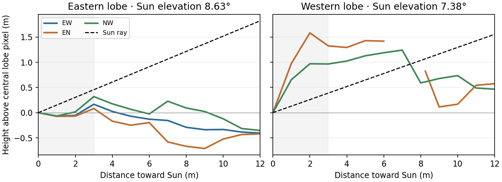

# Solar horizons at the northwestern McGetchin feature

At 1.36151°N, 67.16426°E, the post-impact stereo solution contains a raised western flank adjoining a low center. The western flank is tall enough to cast a shadow into the feature under west sunlight. A corresponding eastern obstruction is absent from the resolved height models along the rays examined. These observations favor a low surface beside raised ejecta. The formation of an excavated cavity remains uncertain.

Each panel starts from a pixel in the darker half of the feature and follows the horizontal direction toward the Sun. Terrain above a dashed line can block the direct solar ray. Shading marks distances shorter than 3 m. E, N and W designate the eastern, near-nadir and western December 2025 spacecraft viewpoints. The E–W solution has no valid height at the central western-lobe pixel.

## Solar-ray test

Measurements use the 1 m reference grid with zero at column 229, row 360 (zero based). For each of the nine pixels in a 3 × 3 window at x = ±2 m, y = 0, a ray follows the solar azimuth through each 7-pixel correlation-window stereo surface, sampled every 0.25 m. Bilinear interpolation preserves missing heights. The stereo calculation removes a locally fitted plane from the disparity heights before adding the residual relief to the published digital terrain model (DTM). The resulting horizon estimates assume that the DTM gives the background slope. The horizon table gives angles, distances to their maxima and valid ray fractions for 1–12 m and 3–12 m travel distances.

| Dark lobe and illumination | Solar elevation | Central-pixel horizon from 3–12 m, E–W / E–N / N–W | Pixel tests admitting occultation |
|---|---:|---:|---|
| Eastern lobe, 17 July 2026 | 8.63° | 3.2° / 1.5° / 6.1° | 0/9 in each pair |
| Eastern lobe, 22 January 2026 | 21.14° | 3.0° / 1.4° / 5.9° | 0/9 in each pair |
| Western lobe, 30 July 2026 | 7.38° | unavailable / 23.8° / 17.8° | 7/9 E–N and 7/9 N–W. E–W has substantial gaps along westward rays. |

Restoring the tilt of each fitted disparity plane gives central horizons of 3.4°, 1.6° and 6.6° under the July eastern Sun, and 23.8° and 17.4° under the July western Sun for the two pairs with valid central heights. Both July observations retain the same counts of pixels admitting occultation. A block or a raised crater wall could cast the western shadow. On the eastern side, darkening could arise on an inclined, directly illuminated surface or beneath an unresolved obstruction. The finite stereo correlation window smooths small relief. The three pairs share images and sample the same terrain. Their overlapping windows test sensitivity to position.

To reproduce the tilt check, add the removed planar term to each height raster before tracing the ray. For eastward and southward offsets in metres, the slope coefficients in metres per metre are (+0.004549, −0.007886) for E–W, (+0.001468, −0.008283) for E–N and (+0.009011, −0.009574) for N–W. The plane intercept cancels when calculating the height above the starting pixel. These slopes come from the 7-pixel fit in [the stereo calculation](../mcgetchin/triangulate.py).

## Dependence on the height reference

A local plane fitted on the 12–18 m annulus places the central 1.71 m-radius disk 0.34, 0.49 and 0.24 m below the plane for E–W, E–N and N–W. The flank 5 m west stands 0.57–0.78 m above those planes. With the reference annulus moved to 16–22 m, the central deficits become 0.23, 0.46 and 0.06 m. The published 3 m-post DTM by itself is almost level over the inner measurement. These measurements depend on the fine-scale stereo solution and its correlation window. All these surfaces are post-impact. They cannot establish loss of material relative to a pre-impact elevation surface.

## Data and reproduction

The archive includes 47 × 47 pixel registered cutouts around the site, pairwise stereo residuals and the corresponding DTM crop. The coarse terrain and primary calibrated images are distributed with [*A New 222-m Diameter Lunar Crater*](https://doi.org/10.5281/zenodo.21481275). The Sun directions use the PDS subsolar coordinates at the candidate's position. The corresponding NAC products are [M1538900584LC](https://data.lroc.im-ldi.com/lroc/view_lroc/LRO-L-LROC-3-CDR-V1.0/M1538900584LC), [M1540060927RC](https://data.lroc.im-ldi.com/lroc/view_lroc/LRO-L-LROC-3-CDR-V1.0/M1540060927RC) and [M1523687730LC](https://data.lroc.im-ldi.com/lroc/view_lroc/LRO-L-LROC-3-CDR-V1.0/M1523687730LC).

Run `python shadow_horizon.py` with NumPy, SciPy and Matplotlib to regenerate both CSV files and the figure. The numerical libraries use up to four threads per process.
