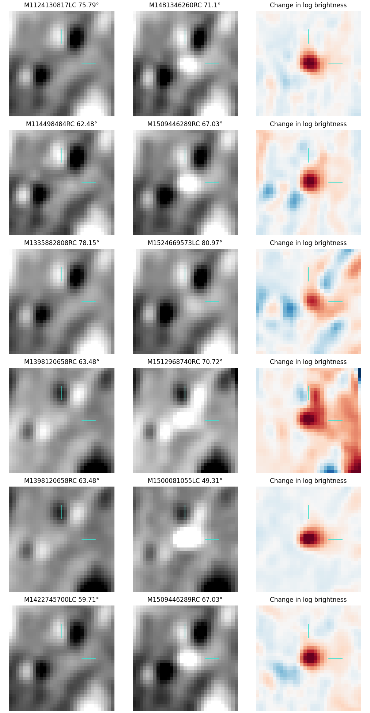

# A surface change predating NELIOTA flash 283

LROC Narrow Angle Camera observations place the appearance of this bright marking **between 10 November 2022 at 18:53:52 UTC and 13 March 2023 at 01:00:42 UTC**, a 122.25-day interval. It lies in the image field of flash 283, which NELIOTA recorded on 25 May 2023. The marking was already visible about 73 days earlier. The dated images rule out that flash as its cause. [NELIOTA observing campaign](https://neliota.astro.noa.gr/) · [LROC observations](https://data.lroc.im-ldi.com/lroc/view_lroc/LRO-L-LROC-3-CDR-V1.0/M1433308510RC)

The reference position is **sample 2189.7645, line 34419.4267**, counting from zero, in M1491897245LC, near 276.99° E and 6.10° S. Each later or earlier image was located with surrounding terrain landmarks. A disk of radius 70 grid pixels around the candidate was excluded from matching. The grid uses 0.95 m/pixel, east to the right and north up. Notice the two small, older depressions just northeast and southwest of the marking. Their repeated appearance ties the site together visually.

| Acquisition | Incidence and sunlight | Core brightness contrast* |
|---|---|---:|
| 21 Apr 2022 | 25.27°, east | +0.023 |
| 14 Oct 2022 | 30.15°, east | +0.021 |
| 10 Nov 2022 | 59.71°, east | −0.003 |
| 13 Mar 2023 | 13.49°, east | +0.221 |
| 9 Apr 2023 | 41.32°, east | +0.240 |
| 5 Sep 2023 | 21.36°, east | +0.222 |
| 28 Feb 2024 | 32.84°, east | +0.221 |
| 19 Jan 2025 | 25.06°, east | +0.241 |

*Natural logarithm of the mean intensity in a 3-pixel-radius disk divided by the mean at radii of 13–25 pixels. The November–March dates delimit a change in the terrain; illumination affects the exact contrast. The January 2023 pair has nominal footprint edges about 1.9 and 5.8 km from the site. Both views were near nadir. Data are available in the [LROC PDS archive](https://pds.lroc.im-ldi.com/).

## What the shadows show

Six temporal comparisons sample incidence angles from 49° to 81° with the Sun on either side of the site. The most grazing comparison uses eastern sunlight in M1335882808RC (78.15°, 1.74 m native pixel width) and M1524669573LC (80.97°, 1.84 m). A sharper eastern pair uses M1124130817LC (75.79°, 1.05 m) and M1481346260RC (71.10°, 0.87 m). M1367641457RC recorded the area under western sunlight at 82.62° in 2021. Its 68.71° off-nadir view has 4.18 m cross-track pixels and failed the terrain-link criteria. The evidence for western illumination comes from the successfully registered 63.48° pre-change image and later observations at 49.31° and 70.72°.



The fields above span 29.45 m across. Each row shows pre-change terrain, post-change terrain, and the temporal change in log brightness. Red indicates a brightness increase. Each pair uses a gain, offset and translation fitted to the terrain beyond 12 pixels from the candidate. A common Gaussian smoothing of 0.8 pixel reduces sensitivity to interpolation differences. Results and 58–116 local control placements per pair are in matched-light.csv.

Under eastern sunlight both nearby depressions show a darker eastern interior. The eastern-minus-western mean log brightness in their 4.5-pixel-radius disks ranges from roughly −0.23 to −0.71 in the three eastern pairs with incidence greater than 62°. Both depressions reverse polarity under western sunlight. At the marking itself, the *new* component is brighter in the eastern half under both illumination directions, with an east-minus-west temporal change of +0.06 to +0.12. No fresh dark central lobe stands out in the fixed 5-pixel-radius test. Its minimum residual falls within the 34th–87th percentiles of the nearby comparison sites. The eastern and western illumination tests agree on the emergence of bright surface material. A new resolved crater cavity, rim diameter and relief sign cannot be established.

## Reproduce

Keep this directory beside the reconstructed directory, which provides the image and terrain-matching primitives. The two commands producing the quantitative tables use the included off-target terrain solutions. The image command fetches the public PDS native image rows needed to build the tiles. A local folder containing full-resolution IMG products may also be supplied in the second positional argument. Threads are limited to four per process for OpenCV and BLAS. There is no download or processing deadline.

```sh
python images.py replay replay --manifest observations.json
python sequence.py replay . replay/sequence
python shape.py replay . replay/shape
```

The 22 cutouts underlying the sequence are supplied in cutouts.npz. The file matched-light.npz contains the fitted pre image, post image and residual for each independent acquisition pair. Intensities in these three layers are logarithmic. centers.json identifies the native search-tile centers, the source image used for each terrain tie, its off-target match count and spatial holdout residuals. locate.py and pairs.py provide the terrain-matching procedures. coverage.csv lists the surrounding ODE observation footprint candidates and the January flyby. [LROC team/Arizona State University, NASA and GSFC](https://lroc.im-ldi.com/) · [NASA Planetary Data System Orbital Data Explorer](https://ode.rsl.wustl.edu/moon/)
