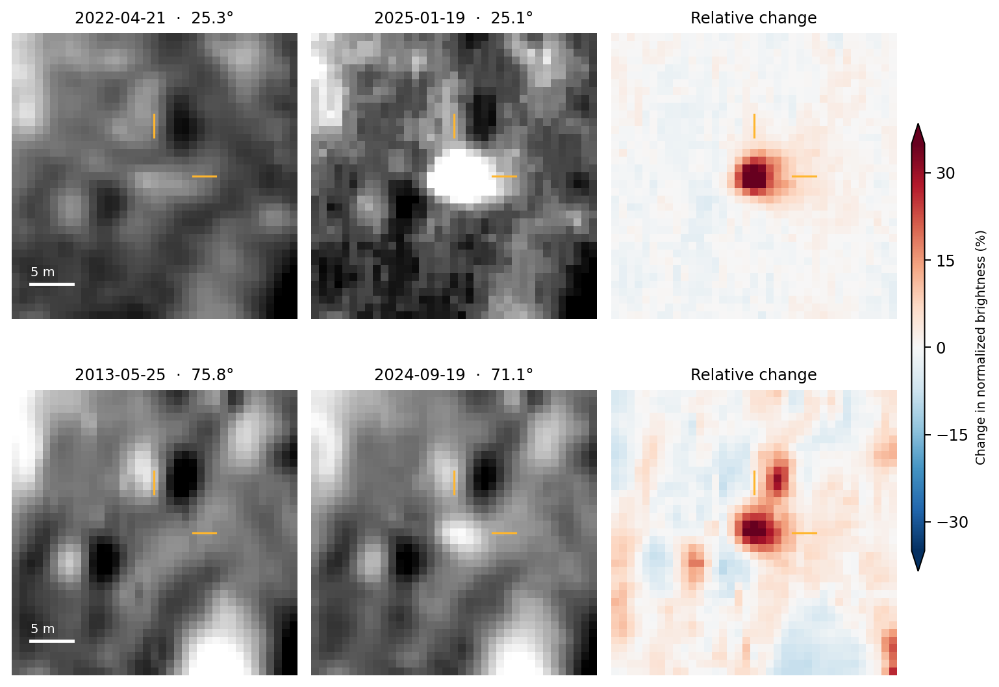

# Two western-nearside impact-flash fields

The primary calibrated LROC NAC pairs cover 81.572 km² around NELIOTA flash 281 and 117.805 km² around flash 283. An independent pair in the 283 field covers 51.014 km², of which 4.282 km² overlaps the main usable-pixel mask on the nominal grid. Per-pair masks and flags are in the numbered directories. The secondary pair covers different terrain, and the compact temporal brightening in the primary field falls outside its registered search mask. A separate, local terrain alignment did recover both of its source images at the brightening. Rounded spacecraft footprint coordinates are an approximate starting point for a native-image search.

| Dataset | Before | After | Pixel scale (m) and illumination |
|---|---|---|---|
| 281 | M1354591042LC | M1528095387LC | 1.048/0.792 m, incidence 61.75°/59.98° |
| 283 | M1405157120RC | M1491897245LC | 0.947/0.861 m, incidence 25.27°/25.06°, ground solar bearings 78.67°/80.46° |
| 283-repeat | M1420405483LC | M1463782498LC | incidence 30.15°/32.84°, ground solar bearing difference 4.06° |

The three pairs yielded 12,951, 2,103 and 3,595 spatially distinct brightness flags, respectively. A screen for a compact new structure on previously quiet terrain retained 33, 73 and 152 of them. The repeat-field contact sheets show old craters, boulders, changes at their edges and differences in shadow. Two faint bright candidates in field 281 were already brighter in September 2021, long before the 24 May 2023 flash. The most persuasive temporal change lies in the main 283 field.

At approximate 6.10273° S, 276.99227° E, the core's brightness relative to the terrain rose by 29.78% in the closely matched 2022–2025 pair. Twenty-eight comparison apertures on a fixed local grid ranged from −1.50% to +2.30%. An independent 2013–2024 pair with low Sun gave +25.79% at the target and −8.17% to +11.59% at 26 comparison sites. These empirical ranges describe the nearby scene. The candidate was selected in a large survey, and these numbers do not estimate its probability of being a crater. The orange ticks indicate the target on the same 34 m field in each panel. Gray levels share a common scale within a row after normalization to local terrain. The date and incidence angle are above each panel.



The last faint and first bright observations are detailed in [the 22-observation time series](../nel283-shape/README.md). March and April 2023 show that the marking already existed before flash 283 on 25 May 2023. The physical source remains unidentified.

## Reproduction

Python requires numpy, scipy, pandas, shapely, opencv-python, Pillow, matplotlib, requests and threadpoolctl. To regenerate a full survey in a fresh folder, use the following commands from this directory. The first step downloads the PDS products listed in the field file, then verifies their data checksums. The large full-strip cutouts generated by the search are used by the next two steps. The distributed ranked tables, masks and contact sheets do not require those cutouts to read.

```console
python search.py 283/field.json raw rerun
python review.py rerun
python emergence.py rerun
python followup.py 283/field.json observations-283.json -3532 6682 raw candidate
python measure.py candidate
```

The final command reads `candidate/chips.npz` and `candidate/dates.csv` and writes `brightening.png` and `brightness-controls.csv` in that directory. To repeat the photometry without downloading the image strips, run `python measure.py`. This uses the archived cutouts in `283/check-24` and writes the figure and table beside the script.

Use 281/field.json or 283-repeat/field.json for the other two pairs. To generate secondary contact sheets for the entire ranking, add `--all-sheets` to review.py. The code uses up to four OpenCV and four BLAS threads per processing worker. Search.py visits every tile intersecting the padded common footprint and masks failed registration and invalid edges. The scientific thresholds are in registration.py, search.py and emergence.py. No crater-detection completeness function has been established. The field geometry and score tables are archived as flashes.csv and pairs.csv. To regenerate field selection, save the output of `pdftotext -layout` for [Liakos et al., arXiv:2403.19613](https://arxiv.org/abs/2403.19613) as paper.txt next to select_field.py, then run that script. It requests the full image inventory for each selected flash from NASA PDS Geosciences Node Orbital Data Explorer, verifies its count and computes ground solar bearings from the subsolar latitude and longitude.
