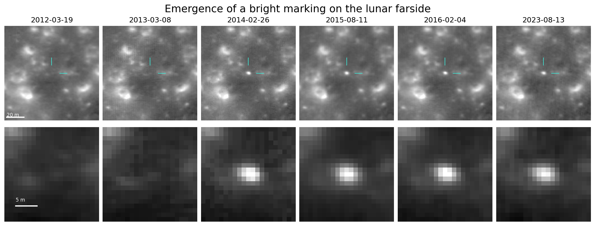

# A persistent bright marking in the N13 lunar farside field

A compact surface marking appeared between **8 March 2013 and 26 February 2014** and persisted through **13 August 2023**. Two pre-change acquisitions show ordinary soil at its position. Four later images under similar high Sun show a 9.5–10.8% rise in brightness relative to the immediate surroundings and the mean pre-change contrast. The shape is consistent with an impact-related albedo marking. The available images leave its origin, any associated cavity and the distinction between primary and secondary impacts unresolved.



## Position and prior work

The center falls at zero-based sample **3201.09**, line **19172.55** in calibrated NAC image **M1148028911RC**. On the JAXA Kaguya terrain camera morning mosaic the surrounding terrain places the marking at **226.04624° E, 7.65592° S**. Two independent NAC dates provided 92 and 96 off-target template matches, respectively, with held-out 90th-percentile residuals of 6.5 and 5.6 m. An independently projected LROC WMS terrain tie gave 226.04666° E, 7.65658° S, approximately 24 m away. The disagreement reflects inter-map registration and limits the precision of the absolute position. The native sample and line identify the marking unambiguously. The reference image's rounded corner interpolation alone places it roughly 300 m farther east. [JAXA Kaguya TC map archive](https://data.darts.isas.jaxa.jp/pub/pds3/sln-l-tc-5-morning-map-v4.0/) · [USGS account of Kaguya map registration](https://www.usgs.gov/media/images/kaguya-tc-ortho-v02-global-mosaic-474m-64ppd)

Sokołowska et al. listed the survey images as the likely pair for unresolved entry **N13**. Their approximate position is **10.78 km** from the marking. This constitutes an independently located surface change in the published search field. Association with their original map marker is uncertain. The closest crater in the released LROC 222-row catalog lies 57.82 km away. The nearest Sokołowska resolved crater is 57.86 km away and the nearest of their listed splotches is 1,173 km away. Sheward et al.'s twelve reported sites are on the Earth-facing hemisphere. Speyerer et al. describe over 500 craters in 2020 and over 600 in 2026. A complete coordinate list for the expanded craters or the roughly 47,000 early splotches was unavailable for this comparison. The first identification of this marking therefore remains undetermined. [Sokołowska et al. data and PCC abstract](https://zenodo.org/records/15755155) · [LROC crater shapefile](https://data.lroc.im-ldi.com/lroc/view_rdr/SHAPEFILE_GLOBAL_NEW_CRATERS) · [Speyerer et al. 2016](https://doi.org/10.1038/nature19829) · [Sheward et al. 2025](https://doi.org/10.1051/0004-6361/202555481) · [2020 LPSC survey](https://www.hou.usra.edu/meetings/lpsc2020/pdf/2369.pdf) · [2026 LPSC survey](https://www.hou.usra.edu/meetings/lpsc2026/pdf/1944.pdf)

## Survey and surface measurements

The survey traversed the complete nominal intersection of the original NAC strips (135.89 km²). Registration and edge masks retained **95.40 km²**, or 86,533,271 pixels at 1.05 m. Of 215 candidate tiles, 169 contributed usable pixels. Their median affine tie count was 1,076 and the median of their median inlier residuals was 0.65 grid pixel. Signed local extrema after filtering the log image ratio at Gaussian scales of 2 and 5 pixels gave 141 flags (score ≥3.5 and amplitude ≥0.035). The marking was the strongest standardized excursion, at 14.42. This score ranks candidates and has no Gaussian-tail probability interpretation. The nearest flag to the nominal N13 map position lies 2.90 km away. Only 36% of the 1-km disk around the nominal point was in the valid search mask.

A 2.5-pixel aperture relative to a 6–12-pixel annulus reproduces the central change in separate 2014, 2015, 2016 and 2023 observations. The largest difference among 48 nonoverlapping control apertures relative to the pre-change baseline was 0.0070 in log contrast. Fitting the median post/pre log ratio yields an observed central full width at half maximum of **3.55 × 5.13 m**. Instrument response and resampling broaden those widths. The 5–8-pixel annulus shows a weak 0.63% brightening above the far background. A separate ring or ejecta boundary cannot be reliably traced.

At post-change incidence angles of 33–34° with the Sun to the west and 48–53° with the Sun to the east, the center remains bright. The 0.88 m/pixel acquisition M1229246404RC is the sharpest cross-illuminated view by pixel width. In the comparison of two pre-change, eastern-Sun 78–82° images with a 2015 eastern-Sun 79.79° image, the center is weakly darker. Its aperture residual falls at the 10th–16th percentiles of 164 neighboring placements and its peak-to-trough variation at the 18th–32nd percentiles. Grazing light supplies no distinctive new shadow or resolved rim. Cross-light translations use terrain at least 70 pixels from the target. Their accumulated interpolation errors span several pixels, comparable to the central marking.

## Reproduction

Install NumPy, SciPy, pandas, OpenCV's Python package, Shapely, matplotlib and requests. Run from this directory. The first command repeats the main photometry from the included arrays. The second downloads the two complete raw input strips, verifies their PDS image checksums, retrieves required native lines for follow-up strips, and rebuilds the survey, cutouts, illumination tests and Kaguya map tie. Computational work uses up to four OpenCV/BLAS threads per process. The program sets no download or processing deadline.

```sh
python photometry.py site-2432-10103.npz measurements
python reproduce.py replay
python catalog.py replay/catalogs 226.04624 -7.65592 replay/results/catalog.csv
```

The signed peaks, coverage masks, tile summaries and six-page visual atlas document detection across the field. Each atlas entry shows before, after and the filtered temporal residual. The raw-follow-up manifest is in observations.json. Absolute source coordinates for each product are in native-locations.csv. The chronological contrasts, individual fitted widths, radial measurements, grazing-light comparison, and Kaguya control ties each have a separate CSV. Kaguya morning has several accepted ties. The evening mosaic produced no qualified solution. Fourteen of fifteen inspected daylit NAC images supplied terrain ties at the site. M1186879028LC at 86.75° failed the off-target tie criteria.

LROC calibrated imagery is credited to NASA, GSFC, Arizona State University and the LROC team. The Kaguya Terrain Camera mosaics are a product of the SELENE mission and the JAXA LISM science team. The field selection and published comparison tables acknowledge Sokołowska et al., Speyerer et al., Robinson et al. and Oberst et al. [LROC/PDS image archive](https://data.lroc.im-ldi.com/lroc/view_lroc/LRO-L-LROC-3-CDR-V1.0/M1148028911RC) · [Kaguya TC source collection](https://darts.isas.jaxa.jp/en/missions/kaguya) · [Sokołowska et al. catalog citations](https://zenodo.org/records/15755155) · [Robinson et al. 2015](https://doi.org/10.1016/j.icarus.2015.01.019) · [Oberst et al. 2012](https://doi.org/10.1016/j.pss.2012.10.005)
