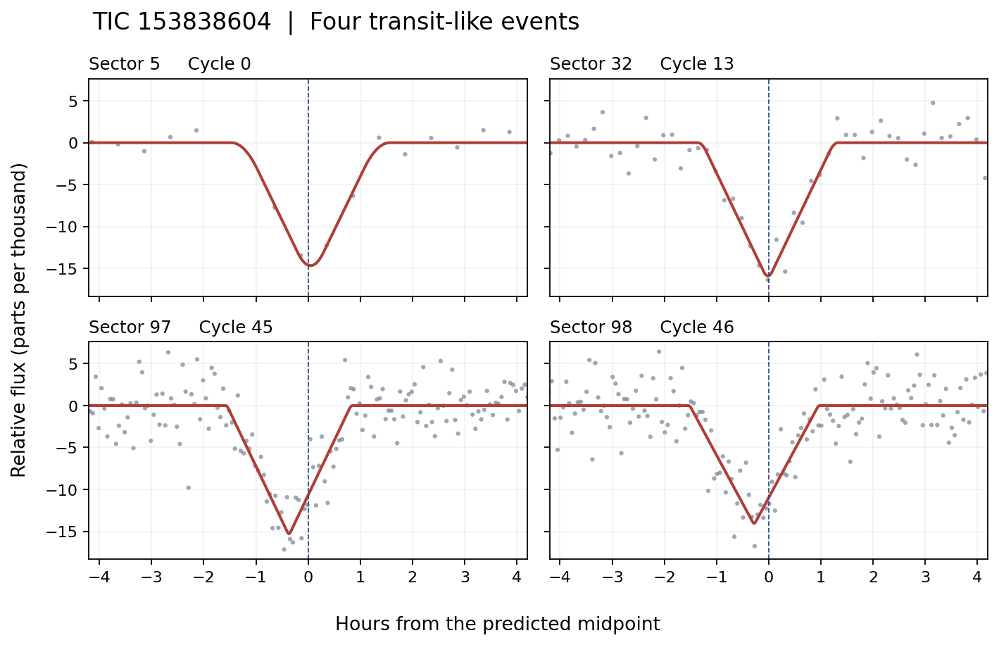

# What eclipses TIC 153838604?

**Four TESS eclipses recur every 56.07936 days. A giant planet and a faint red dwarf both fit the light curve.** The two example orbits predict stellar radial-velocity semiamplitudes of 61 m/s and 6.84 km/s, respectively. A search of public archives on 20 November 2026 recovered no radial-velocity time series that could distinguish them. [Read the research note (PDF)](paper/tic-153838604.pdf) · [LaTeX source](paper/tic-153838604.tex)

## Findings

| Question | Evidence |
|---|---|
| How often does the target dim? | The four eclipse times in 2018, 2020 and 2025 agree with a 56.07936-day recurrence to within 3.2 minutes over seven years. A 112.16-day binary could produce alternating eclipses at this interval. [Timing measurements](duotransit/measurements.csv) |
| Where does the light disappear? | In the two 2025 difference images the loss centroid lies within 0.08 TESS pixel of the target. An unresolved neighbour remains possible. [Difference images and controls](duotransit/pixels/README.md) |
| Could the companion be a star? | TESS places a nominal 95% upper limit of 0.071% on a recurring 2.5-hour eclipse halfway through the 56-day cycle. The Gaia colour–magnitude comparison disfavors two ordinary equal-light stars. A faint red dwarf can produce the primary eclipse and pass outside the primary star's disk at the opposite conjunction. [Secondary-eclipse tests](companion-vetting/photometry/README.md) · [Gaia comparison](companion-vetting/blends/README.md) |
| Can other wavelengths or velocities distinguish the examples? | Four ASAS-SN observations in the expected primary windows and one usable mid-eclipse WISE infrared measurement leave the eclipse colour uncertain. The Gaia DR3 velocity combines 22 visits. [Optical](companion-vetting/ground-asassn/README.md) · [Infrared](companion-vetting/infrared/README.md) · [Spectroscopy](companion-vetting/spectroscopy/README.md) |

Hawthorn et al. identified this object as a duotransit candidate from the first two TESS events. This analysis uses two additional eclipses to test the timing and compares physical explanations. Publication priority for the ephemeris has not been established. The target is **CTOI 153838604.01**, also **Gaia DR3 4788303839668784896**. [Discovery paper, tables A2–A3](https://arxiv.org/html/2310.17268) · [ExoFOP target record](https://exofop.ipac.caltech.edu/tess/target.php?id=153838604)

## Reproduce the results

The [reproduction guide](REPRODUCING.md) lists the inputs, Python environment and commands. The [timing analysis](duotransit/README.md) gives the four eclipse measurements and input hashes. The [companion analysis](companion-vetting/REPORT.md) links the physical models, survey measurements and statistical controls.

The repository license covers the original text, figures and analysis code. Survey observations and catalogues retain the terms of their originating projects. [Data sources and acknowledgments](DATA-SOURCES.md)
