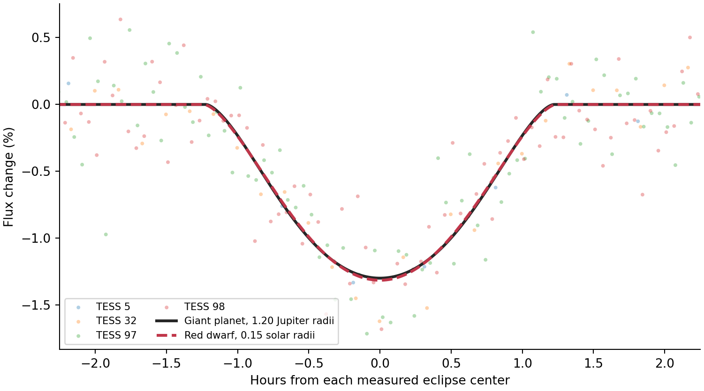

# What eclipses TIC 153838604?

**A giant planet and a faint red dwarf both fit the public observations available on 20 November 2026.** TESS locates the light loss close to TIC 153838604 and measures a recurrence every 56.07936 days. An ordinary pair of equally bright stars is a poor match to the star's luminosity and colour. An eccentric orbit with a faint stellar companion accounts for the eclipse shape and all three well-observed absences of a halfway eclipse. A brown dwarf or an unresolved blend also remains possible. ExoFOP lists the system as community planet candidate CTOI 153838604.01. [Discovery paper](https://arxiv.org/html/2310.17268) · [ExoFOP](https://exofop.ipac.caltech.edu/tess/target.php?id=153838604) · [Four-event timing and difference imaging](../duotransit/README.md)

## Two physically distinct orbits that reproduce the observed eclipse

The two examples below use the TIC primary mass of 1.00 ± 0.12 solar masses and radius of 0.906 ± 0.046 solar radii, fixed to the central values. Each model fits the same 632 good-quality exposures in four 14.4-hour windows, including the out-of-eclipse baselines. Its two nonlinear parameters are the projected speed and the closest approach in units of the primary radius. Each sector has its own linear flux baseline. The model integrates over each exposure, uses quadratic limb darkening and weights by the measured scatter outside eclipse. The figure shows the instantaneous profiles. The scatter of individual measurements outside eclipse is 0.137–0.254%. [Host properties](https://exofop.ipac.caltech.edu/tess/target.php?id=153838604&json) · [Input data](../duotransit/measurements.csv) · [Model calculations](eclipse_models.py)

| Quantity | Giant-planet example | Red-dwarf example |
|---|---:|---:|
| Assumed mass | 1 Jupiter mass | 0.12 solar masses, about 126 Jupiter masses |
| Assumed radius | 1.20 Jupiter radii | 0.15 solar radii |
| Assumed companion/primary TESS flux | 0 | 0.001 |
| Fitted primary impact parameter | 0.922 | 0.973 |
| Weighted sum of squared residuals, χ² | 665.64 | 664.45 |
| Eccentricity in one explicit orbit | 0.491 | 0.426 |
| Projected separation at opposite conjunction, in primary radii | 2.70 | 2.41 |
| Separation required for any disk overlap | below 1.136 | below 1.165 |
| Predicted radial-velocity semiamplitude of primary | **61 m/s** | **6.84 km/s** |

The greatest predicted flux difference between these examples at a native TESS exposure is **0.0156 percentage points**. The quoted eccentricities give concrete solutions in which the primary eclipse occurs at periastron. Each orbit also reproduces the absence of a secondary eclipse because the companion misses the stellar disk on its return. Replacing straight-line motion across the stellar face with the corresponding exact Kepler orbit changes the primary profile by less than 4 parts per million. These eccentricities are illustrative and depend on the adopted stellar parameters. [Exact orbit checks](orbit-examples.json) · [Fixed-radius and limb-darkening comparisons](eclipse_models.csv)

The example masses and companion light are assumptions. The light curves primarily constrain projected area, speed and offset. Neither the small χ² difference nor the absence of a secondary supplies odds for the mass classes. Stellar and giant-planet radii overlap even in systems with directly measured masses. [An 85-Jupiter-mass star measured at 0.84 Jupiter radii](https://doi.org/10.1051/0004-6361/201731107)

## Tests of stellar companions and blends

| Evidence | Finding | What it establishes |
|---|---|---|
| TESS secondary eclipse | In three observed halfway windows the combined depth is −0.0141%, with 0.0472% empirical scatter and a nominal one-sided 95% upper limit of **0.071%** for a recurring 2.5-hour triangular eclipse. | A bright, comparably deep secondary at phase 0.5 of 56.07936 days is disfavoured. An eccentric orbit can move or eliminate the secondary. |
| TESS alternating eclipses | Four eclipses span seven years. The default-aperture even-minus-odd depth difference is −0.071 percentage points, compatible with zero. Its magnitude changes with extraction aperture. | If primary and secondary look alike, a 112.15872-day binary could produce these events. It would need similar eclipse depths and near-half-orbit spacing. |
| Light-loss position | The difference-image centres in the two 2025 sectors lie within 0.08 TESS pixel of the target. The nearest distinct Gaia DR3 source is 49.56 arcseconds away. | Distant resolved neighbours are poor matches. The difference images supply no subarcsecond exclusion around the target. |
| Luminosity and colour | Gaia gives absolute G magnitude 5.038 for the unresolved source. Splitting the light equally gives each star an absolute magnitude of 5.790 at the same colour, fainter than every one of 172 nearby comparison stars selected by colour, distance and parallax quality. | Ordinary equal-colour, equal-brightness main-sequence twins are disfavoured. The comparison does not test a faint red dwarf beside a solar-type primary, or a diluted background binary. |
| Gaia astrometry | RUWE is 1.381, above a published direction-dependent threshold of 1.238. In a separate local comparison matched in apparent magnitude and colour, 154 of 839 stars have RUWE at least this high. No DR3 two-body orbit was reported. | Gaia's single-star position model fits imperfectly. The residual has no identified period or companion mass. |

The halfway limit assumes the same observed depth in each window and representative off-event noise. A scan in phase gives pointwise depth limits below 0.5% for 95.4% of the unmasked 56-day phase grid for the same 2.5-hour shape. Coverage depends on duration, phase and detrending. Several faint infrared detections or catalogue entries fall closer than the nearest Gaia source. Their optical brightness and association with the target are uncertain. [TESS tests and controls](photometry/README.md) · [TESS pixel analysis](../duotransit/pixels/README.md) · [Gaia field and colour–magnitude comparison](blends/README.md) · [Local RUWE method](https://doi.org/10.1051/0004-6361/202450172)

## Independent wavelengths

**ASAS-SN optical.** Sky Patrol V2 returns 1,820 measurements matched to the exact Gaia source, including 1,616 of good quality. Four separate primary events have one good observation each, all in the bluer *g* band. Each point is fainter than its same-camera local baseline. A set of 39 comparison stars at 15–30 arcminutes separation supplies same-image calibration for all four. Relative to control nights within 30 days, the triangular-template depth is **2.82%** with a nominal empirical interval of **1.09–4.37%**. Applying exactly the same estimator at exactly the observed times to the achromatic TESS models predicts **1.51%**. Ten closer reference stars cover only three events with enough comparison measurements and yield an interval that includes zero. The sparse ground data support dimming at the expected times. They leave any colour dependence unresolved. [Survey](https://asas-sn.github.io/skypatrol/) · [Individual corrected measurements](ground-asassn/outer-field/differential-0-events.csv) · [Achromatic predictions](ground-asassn/achromatic-predictions.csv)

An exact four-night check reassigns each observed epoch among its comparison nights, refitting the baseline and noise weight each time. In the wider reference field, 50 of 19,551 assignments dimmed at least as much under the zero-eclipse assumption. Under the two achromatic TESS models, about 7.7% of assignments dimmed at least as much as observed. These fractions assume exchangeable control nights. [ASAS-SN methods](ground-asassn/README.md) · [Finite-control tests](ground-asassn/permutation.csv)

**WISE infrared.** One clean 4.6-micron measurement falls 2.78 minutes after a predicted primary centre, on 16 January 2023. Against 18 comparison exposures from the same observing visit, the inferred flux loss is **3.04% ± 2.78%**. Its uncertainty includes the optical depth, and zero is only 1.1 standard errors away. A detector flag affects the simultaneous 3.4-micron measurement. There is no reliable infrared eclipse colour. [WISE measurements and quality flags](infrared/README.md) · [WISE and NEOWISE public archive](https://irsa.ipac.caltech.edu/Missions/wise.html)

**KELT-South.** The NASA S20 archive contains 4,243 raw measurements and 4,160 in its detrended products. Eight exposures fall inside a primary window on one night, and ten inside a halfway window on one other night. For the primary the night-matched detrended estimate is 6 millimagnitudes, with an empirical control range of −97 to +53 millimagnitudes. Both zero and a TESS-strength eclipse lie inside. These clustered exposures provide one primary test night. A NASA SuperWASP archive lookup returned no target within the coordinate search box (±0.005 degrees in each axis). [KELT measurements and source files](ground-kelt/README.md) · [NASA KELT archive](https://exoplanetarchive.ipac.caltech.edu/docs/KELT.html)

## The mass measurement

Gaia DR3 reports a combined radial velocity of **+75.61 ± 2.03 km/s** from 22 visits spanning 888 days. For this source the error describes the combined spectral correlation peak. Gaia did not publish individual velocities or an epoch-scatter statistic for it. Searches of the public ESO, GALAH, RAVE, Gaia–ESO, APOGEE, SDSS-V and ExoFOP holdings recovered no usable time-resolved velocities. The direct Gemini search yielded no coverage determination. [Archive queries and results](spectroscopy/README.md) · [Gaia RV methodology](https://arxiv.org/abs/2206.05902)

Measurements at multiple orbital phases can distinguish the **61 m/s** and **6.84 km/s** examples above. Fitting the velocity orbit would constrain the companion mass, given the host mass and the eclipsing inclination. If the bright star remains stationary at high precision, unresolved blends warrant separate testing with spatially resolved eclipse photometry or high-angular-resolution imaging. Gaia has scheduled its fourth release for **2 December 2026** with epoch spectroscopy. The release must be checked for this specific star, including precision and phase sampling. Use Gaia DR3 source **4788303839668784896** and the DR3-to-DR4 crossmatch. [Gaia release schedule](https://gaia.aip.de/cms/data/catalogues/) · [DR4 products](https://www.cosmos.esa.int/web/gaia/dr4)

## Reproduction and scope

With the sibling `duotransit` directory preserved, run `python eclipse_models.py` here and the scripts in the evidence subdirectories. The physical model requires NumPy, SciPy, Astropy, Matplotlib and batman-package. The ASAS-SN scripts also use pandas, PyArrow and requests. The raw target and reference-star extracts are supplied as Parquet files. [TESS method](photometry/README.md) · [RV archive and access notes](spectroscopy/README.md)

The two-parameter occultation fits have a ceiling of 200 function evaluations and converged in 5–10. The five-parameter TESS timing fits inherit a ceiling of 500 and also raise an error on nonconvergence. Every fit used for the reported results converged. On the archive side, LCO allows 1,000 anonymous requests per 24 hours and 1,000 rows per page. The NOIRLab default is 1,000 rows per page. Neither truncated the search. The searches covered publicly accessible products and the archived observing times. No follow-up observations were commissioned.
