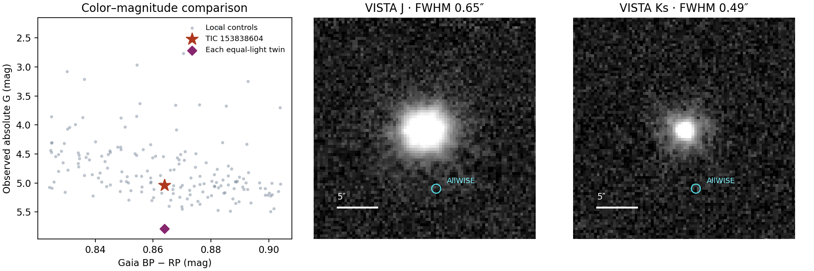

# Companions and contaminating light near TIC 153838604

The Gaia color–magnitude diagram disfavors an ordinary pair of equal-light stars at the target distance. The astrometry leaves room for an unresolved companion. The available archival images lack a measured target-specific contrast curve, and the Gaia radial velocity supplies no orbital mass constraint. A faint eclipsing M dwarf, a brown dwarf, and a diluted background or hierarchical system remain viable on these tests.

The diamond shows the luminosity of each star if two identical stars supply the measured light. The images are 28 arcseconds wide in the original detector orientation. A circle marks the faint northern AllWISE entry. Both exposures date to 24 December 2012 and precede the TESS observations. [Gaia DR3](https://gea.esac.esa.int/archive/) · [VISTA Hemisphere Survey](https://doi.org/10.18727/archive/57)

## Does the light look like two ordinary equal stars?

Gaia DR3 4788303839668784896 has G = 12.92431, BP−RP = 0.86393 and parallax 2.64678 ± 0.01740 mas. Direct inversion gives 377.82 pc. Its observed absolute G magnitude, without extinction or parallax-zero-point corrections, is 5.038 ± 0.014 (parallax contribution). An equal-light pair of identical color would require each to have absolute G = 5.790. For an empirical comparison, 172 other field stars within three degrees, with parallaxes corresponding to 300–500 pc and BP−RP within 0.040 mag, meet the signal-to-noise cuts in `queries.md`. Their median absolute G is 4.900, their 5th–95th percentile range is 3.664–5.355 and the faintest is 5.492. All 29 low-RUWE comparison stars with a Gaia photometric metallicity within 0.2 dex of the target's estimate also exceed the required component luminosity. There is no faint absolute-magnitude cutoff or apparent-magnitude cut in this comparison. [Gaia DR3 source data model](https://gea.esac.esa.int/archive/documentation/GDR3/Gaia_archive/chap_datamodel/sec_dm_main_source_catalogue/ssec_dm_gaia_source.html)

The observed colors and luminosity are ordinary for one field star. This control sample favors that interpretation over two otherwise ordinary identical stars. The empirical comparison does not assign false-positive probabilities. Differences in extinction, age, metallicity and composition can change both color and luminosity. A low-light companion has a much smaller effect.

Gaia's single-star GSP-Phot solution gives 6004 K, [M/H] = −0.50, A_G = 0.299 mag and radius 0.918 R☉. The TIC parameters quoted on ExoFOP give 5649 ± 130 K and 0.906 ± 0.046 R☉. Gaia FLAME gives 0.894 R☉ and 0.935 L☉. The difference in fitted temperatures illustrates model dependence. The Gaia Multiple Star Classifier fits an assumed coeval binary to bright BP/RP sources. Here its component temperature intervals span 3000–6715 K and 4061–8000 K. Those fits do not identify a companion. The 2MASS `AAA` magnitudes are J = 11.764 ± 0.020, H = 11.407 ± 0.024 and Ks = 11.367 ± 0.023. AllWISE gives W1 = 11.325 ± 0.023 and W2 = 11.338 ± 0.021. These integrated fluxes come from seeing-limited surveys. [Gaia MSC methodology](https://gea.esac.esa.int/archive/documentation/GDR3/Data_analysis/chap_cu8par/sec_cu8par_apsis/ssec_cu8par_apsis_msc.html) · [ExoFOP target record](https://exofop.ipac.caltech.edu/tess/target.php?id=153838604) · [IPAC 2MASS and AllWISE catalog access](https://irsa.ipac.caltech.edu/TAP/)

## Astrometry and radial velocity

Gaia's single-source fit has RUWE 1.38067, excess noise 0.16368 mas (catalog significance 30.73), 26 visibility periods, 0% multi-peak image windows, 2% odd windows, and IPD harmonic amplitude 0.01158. The catalog duplicate flag is false. The non-single-star bitmask is zero, and the published two-body orbit table contains no matching row. The magnitude of the proper motion is 51.32 mas/yr. It moves the star by only 0.835 arcseconds between the 1999 2MASS image and Gaia epoch 2016.0. This baseline offers limited leverage on a background source hidden by the target in 2MASS. [Gaia DR3 data model](https://gea.esac.esa.int/archive/documentation/GDR3/Gaia_archive/chap_datamodel/sec_dm_main_source_catalogue/ssec_dm_gaia_source.html)

The locally calibrated Castro-Ginard et al. RUWE threshold is 1.23821, including the crowding correction (level-5 ICRS HEALPix RING pixel 10685). The measured RUWE exceeds this threshold. Among 839 other Gaia stars within 3 degrees with similar G and BP−RP, 154 (18.4%) have RUWE at least as large. The field includes real binaries and systematics. This comparison measures how common the observed RUWE is locally. It supplies neither an orbit nor a binary posterior. [Castro-Ginard et al.](https://doi.org/10.1051/0004-6361/202450172) · [GaiaUnlimited threshold map](https://zenodo.org/records/11102437)

Gaia's combined radial velocity is +75.61 ± 2.03 km/s over 22 transits spanning 888 days. Method 2 combines the faint-source cross-correlation functions and yields no published transit scatter or variability probability here. The number is a mean radial velocity, with insufficient information to bound the companion's mass or the velocity semi-amplitude. [Gaia DR3 radial velocity fields](https://gea.esac.esa.int/archive/documentation/GDR3/Gaia_archive/chap_datamodel/sec_dm_main_source_catalogue/ssec_dm_gaia_source.html)

## What could share the photometric aperture?

* The 90-arcsecond Gaia field has 11 entries including the target. The nearest other Gaia source is 49.56 arcseconds away and 7.25 G magnitudes fainter. TIC 153838455, Gaia DR3 4788303805309046784, is 56.14 arcseconds away and only 0.58 G / 0.60 T magnitudes fainter. Its parallax and proper motion differ from those of the target. TIC 153838607 is 55.04 arcseconds away with ΔT = 4.39. Whether light from either source enters an aperture depends on the sector and photometric extraction. [ExoFOP nearby TIC entries](https://exofop.ipac.caltech.edu/tess/download_nearbytarget.php?id=153838604&output=csv)
* An independent VISTA Hemisphere Survey DR5 10-arcsecond query contains two repeat detections of the primary and eight fainter, single-band, low-stellarity entries at 5.17–8.91 arcseconds. The J-only entries have Petrosian J ≥ 18.59 mag. The Ks-only entries have Ks = 16.79 and 17.75. In the inspected VIRCAM detector headers the J and Ks point-spread-function FWHM values are 0.65 and 0.49 arcseconds. Bright-star residuals, catalog deblending and extended sources can contribute. The images supply no calibrated detection completeness close to the target. [ESO VHS catalog](https://www.eso.org/qi/catalog/show/290) · [VISTA survey data](https://doi.org/10.18727/archive/57)
* AllWISE J043217.60−473624.7 lies 7.76 arcseconds north of the target at W1 = 15.678 ± 0.123, W2 = 15.111 ± 0.126. One J-only VISTA entry at 8.18 arcseconds (source 473290090318, J = 19.22 Petrosian mag) lies 0.42 arcseconds from this position. Its faint J magnitude and red J−W1 color make a substantial contribution in the optical unlikely under an ordinary stellar spectrum. Neither catalog measures its TESS magnitude. The DES DR2 central entry has unreliable-photometry flags in all five bands and is unsuitable for this inference. [AllWISE data release](https://irsa.ipac.caltech.edu/Missions/wise.html) · [VISTA DR5](https://doi.org/10.18727/archive/57)
* For an observed depth δ = 0.015723, a blended source undergoing a complete eclipse requires at least δ/(1−δ) of the uneclipsed primary flux in the aperture. With equal aperture throughput and no third light this gives ΔT ≤ 4.491 mag. A 50% intrinsic eclipse gives ΔT ≤ 3.721 mag. Different aperture throughput changes the permitted source-catalog contrast. These thresholds concern TESS-band light. [Hawthorn et al.](https://doi.org/10.1093/mnras/stad3783)

## Published follow-up coverage

The public ExoFOP target record lists CTOI 153838604.01 as a planetary candidate, uploaded by Hawthorn on 24 November 2023. On 20 November 2026 its public inventory returned one planet-parameter entry and zero imaging observations, spectroscopy observations, stellar-companion entries, observing notes or uploaded files. Other names are 2MASS J04321774−4736316, WISE J043217.75−473632.0, UCAC4 212−004500, APASS 22211720 and Gaia DR2/DR3 4788303839668784896. No target-specific diffraction-limited contrast curve appeared in this search. [ExoFOP](https://exofop.ipac.caltech.edu/tess/target.php?id=153838604) · [Original TESS candidate](https://doi.org/10.1093/mnras/stad3783)

The SOAR TESS I and II VizieR tables and the Washington Double Star catalog returned no 10-arcsecond match. The SOAR III preprint reports 2,982 target stars. Its public manuscript samples do not list this TIC, and the authors say that the full machine-readable contrast curves were available on request during peer review. Its full target coverage could not be verified. Direct Gemini archive coverage is unknown. A MAST cone inventory returned TESS, high-level science products and GALEX. ESO phase-3 coverage returned VHS VIRCAM and measurement catalogs. Neither inventory supplies a target-specific speckle or adaptive-optics contrast curve here. [SOAR I](https://doi.org/10.3847/1538-3881/ab55e9) · [SOAR II tables](https://cdsarc.cds.unistra.fr/viz-bin/cat/J/AJ/162/192) · [SOAR III](https://arxiv.org/abs/2608.26250) · [Washington Double Star catalog](https://crf.usno.navy.mil/wds)

Run `python analyze.py` with Python, pandas, NumPy, Astropy and Matplotlib to reproduce the comparison, ordered Gaia neighbor list and figure. The two supplied VISTA science planes retain the measured counts and celestial WCS. `python fetch_vista.py` retrieves and verifies them from ESO. [Archive fields, checksums and control selections](queries.md)
