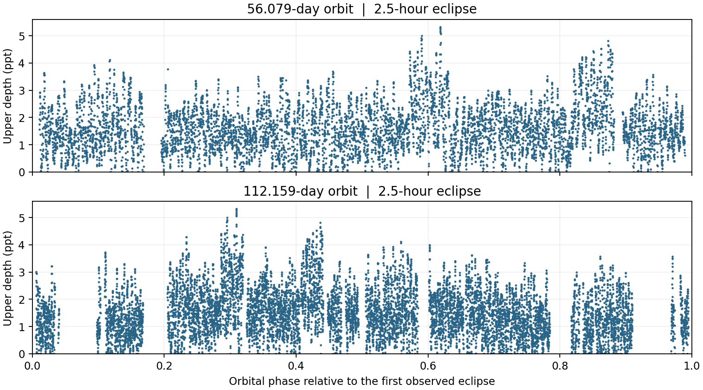

# Companion constraints from seven years of TESS photometry of TIC 153838604

TESS recorded four V-shaped eclipses at a photometric interval of 56.07936 days. A search at the midpoint between those eclipses gives a **0.71 ppt nominal 95% upper bound** for a 2.5-hour triangular secondary of constant observed depth. The four detected eclipses are roughly 14–16 ppt deep in the default aperture. This disfavors a comparably deep secondary eclipse on a circular 56-day orbit. A 112.16-day binary with nearly equal primary and secondary eclipses remains compatible because its secondary would be one of the four detected events. The photometry alone leaves the companion's mass and identity undetermined. [Four-event analysis and images](../../duotransit/README.md) · [Original discovery](https://arxiv.org/html/2310.17268)

## The 56-day orbit

Three well-sampled windows fall at orbital phase 0.5. In a circular orbit this is the approximate epoch of the secondary eclipse. The data in sector 31 are an independent observing season with no previously reported primary dip. A straight baseline and a symmetric triangular loss were fitted around each predicted midpoint, averaging the template over each actual exposure.

| TESS sector | Midpoint (BJD TDB − 2,457,000) | Fitted depth, ppt | Raw-aperture depth, ppt | Comparison-window scatter, ppt |
|---:|---:|---:|---:|---:|
| 31 | 2148.09702 | −0.246 | −0.260 | 1.090 |
| 97 | 3942.63652 | −0.181 | −0.190 | 0.681 |
| 98 | 3998.71588 | −0.015 | +0.016 | 0.848 |

Positive depth corresponds to dimming. The inverse-variance weighted estimate for a 2.5-hour secondary is **−0.141 ppt**, with empirical scatter **0.472 ppt**. To estimate its uncertainty, the same template was measured in 34, 51 and 44 out-of-eclipse windows in the three sectors. All 76,296 combinations of one window per sector were used. The one-sided limit subtracts the fifth percentile of the combined noise from the measured depth. The finite control samples and their representativeness determine its calibration. [Individual measurements](opposite_phase.csv) · [Combined measurements](opposite_phase_joint.csv)

| Assumed secondary duration | Nominal 95% upper depth at phase 0.5 | Largest pointwise upper depth when the centre is shifted by up to 30 min |
|---:|---:|---:|
| 1.25 h | 0.843 ppt | 1.063 ppt |
| 2.5 h | 0.709 ppt | 0.973 ppt |
| 5 h | 1.125 ppt | 1.162 ppt |

The shifted tests use a one-minute grid and a common offset in all three epochs. Shallow secondaries, a secondary outside the measured phases, and configurations with a primary transit alone all remain possible. Eccentricity changes the time, duration and likelihood of a secondary eclipse. The published ephemeris predicts observed dips. It does not fix orbital eccentricity. [Time-offset measurements](opposite_phase_offset.csv)

## The 112-day orbit and the alternating eclipses

If the actual orbital period is twice the photometric period, cycles 0 and 46 are one eclipse type, and cycles 13 and 45 are the other. Both classes include one early and one late sector. In this interpretation the three null measurements above probe orbital quadratures. The relevant comparison is between the four detected eclipses.

| Measured difference | Estimate | Empirical 95% interval |
|---|---:|---:|
| Default aperture, even minus odd peak depth | −0.71 ppt | −2.58 to +0.85 ppt |
| Large aperture, even minus odd peak depth | −0.04 ppt | −2.61 to +1.87 ppt |
| Small aperture, even minus odd peak depth | −3.08 ppt | −4.74 to −1.55 ppt |
| Raw aperture, even minus odd peak depth | −0.80 ppt | −2.64 to +0.78 ppt |
| Default aperture, even minus odd full duration | +0.050 h | −0.328 to +0.373 h |
| Odd eclipse timing displacement from half an orbital cycle | −1.40 min | −6.00 to +4.09 min |

The 112-day model fits an intercept, a period and one time displacement common to odd eclipses. A binary giving the observed alternating events must put the second eclipse close to the midpoint of its orbit. This directly constrains the observed timing offset. An eccentric binary can still give a near-half-period separation for some periastron orientations. Grazing geometry, light-travel time within the binary, and eclipse-shape systematics would enter conversion of that offset into an orbital parameter. [Parity and timing results](parity.json)

The small-aperture difference is visible even after propagating local noise. Its sector-98 eclipse depth is 4.73 ppt in the small aperture, 14.19 ppt in the default aperture and 17.34 ppt in the large aperture. Conversely, the large-aperture depths across all four sectors span only 16.86–17.34 ppt. Each eclipse occurs in a different sector. Thus ordinary noise alone understates the uncertainty in distinguishing a genuine parity dependence from an aperture- or sector-dependent loss of measured depth. The aperture fits share the same exposures and count as one experiment. [All aperture fits](apertures.csv)

Independent SPOC data give crowding factors of 0.955 and 0.954 in the original two eclipse sectors, the estimated fractions of observed aperture light from the target. The corrected SPOC eclipse depths for sectors 5 and 32 are 17.59 and 17.88 ppt. The TIC estimate of contaminating-to-target flux is 0.01635. A common contaminant of that strength changes the depth scale by a factor of 1.01635, assuming an eclipse of the target. The actual aperture response differs between sectors and pipelines. An unresolved source contributing unknown light would give a different intrinsic eclipse depth. [SPOC header values and fits](spoc_apertures.csv) · [TIC target metadata](../../duotransit/catalogue.json) · [MIT pipeline photometry](https://tess.mit.edu/qlp/)

The empirical parity intervals use 15-ppt, 2.5-hour model eclipses injected into measured local backgrounds in each sector. Each injection preserves the original eclipse's exact sampling mask in its core, including the sparse 30-minute sector-5 data. Fits use 30-minute, 10-minute or 200-second exposure integrals as appropriate. The 13, 28, 40 and 32 qualified windows yield 465,920 cross-sector combinations of measurement errors. These reuse finite sets of real control windows. The intervals account for local correlated noise retained within those windows and assume independent sectors. Long-term systematic errors, unknown dilution and a mismatch between the triangle and the true eclipse profile remain outside that calibration. [Injected-event measurements](parity_injections.csv)

## Unknown secondary phase



Each point gives a **local, pointwise** upper depth bound for a 2.5-hour triangle. Blank regions have inadequate phase coverage or control data, or overlap the known events. For each trial phase the witness is chosen from the sector with the smallest control scatter. Its one-sided limit uses a finite-sample rank from independent-in-time comparison windows in that sector. This selection uses sector noise estimates, which also carry uncertainty. The six sectors were searched on a grid with approximately ten minutes between trial midpoints. The grid does not exhaust continuous choices of midpoint, profile or duration.

| Orbit | Eclipse duration | Unmasked phase centres with data | Phase centres with at least two events covered | Phase centres with upper depth below 5 ppt |
|---:|---:|---:|---:|---:|
| 56.079 d | 1.25 h | 96.1% | 65.6% | 91.6% |
| 56.079 d | 2.5 h | 96.1% | 63.8% | 95.4% |
| 56.079 d | 5 h | 94.7% | 58.5% | 92.4% |
| 112.159 d | 1.25 h | 77.9% | 30.5% | 71.5% |
| 112.159 d | 2.5 h | 77.5% | 29.5% | 73.6% |
| 112.159 d | 5 h | 74.4% | 26.7% | 67.4% |

Each percentage uses all unmasked trial phase centres as its denominator, including centres with no data. For 2.5-hour events, 7,903 of 8,076 total phases remain on the 56-day grid and 15,806 of 16,152 on the doubled grid. The known eclipses occupy phases 0 on the 56-day grid and 0 and 0.5 on the doubled grid. The latter grid tests for additional dimming elsewhere and cannot reject a binary whose two ordinary eclipses are already observed. The quoted pointwise bounds do not give a simultaneous confidence band, a survey-wide false-alarm rate, or a probability for the companion to be a planet. Detrending attenuation and secondary morphologies unlike the trial profiles can reduce sensitivity. [Phase summary](phase_summary.json) · [Full phase measurements](phase_sensitivity.csv.gz) · [Sector noise controls](noise_controls.csv)

## Data and reproduction

Six usable TESS sectors cover the target, numbered 4, 5, 31, 32, 97 and 98. Sector 30 also appears in the TESSCut footprint lookup. Its public cutout starts at detector column 2121 and ends at 2129, wholly beyond the imaging region at columns 45–2092. It supplies no stellar photometry. All six usable light curves were read with the zero-quality-flag selection. Sectors 4 and 31 are bundled here. The four eclipse-sector files are in the adjacent [source analysis](../../duotransit/README.md). [All sector hashes and cadences](sectors.csv) · [Detector-footprint measurements](footprint.json) · [NASA detector geometry, figure 5](https://ntrs.nasa.gov/api/citations/20205008729/downloads/EXP-TESS-ARC-ICD-TM-0014-Rev-F_v2.pdf)

With the directory tree preserved, use Python, NumPy, SciPy, Matplotlib and Astropy. The first two commands operate on the bundled FITS data. The third retrieves the public footprint, sector-30 cutout and original SPOC light curves to reproduce the independent checks.

```
python parity.py
python secondary.py
python footprint.py
```

The exposure-averaged nonlinear fit from the four-event analysis inherits SciPy's 500 function evaluations per five-parameter fit and raises an error if convergence fails. Secondary-depth estimation uses linear least squares. Comparisons are restricted to post-pipeline photometry and presume that the reported peak depth refers to the measured aperture light.
