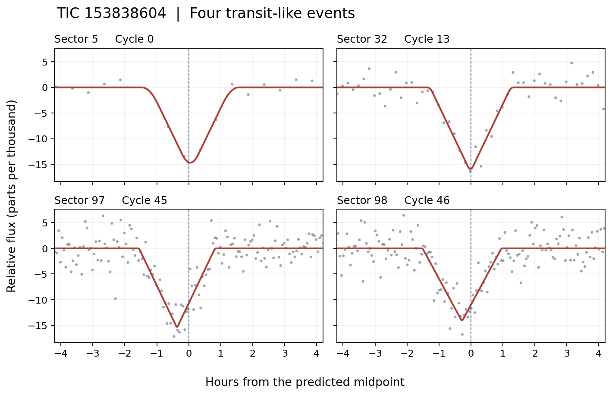

# A 56.07936-day recurrence in the light of TIC 153838604

Two TESS observations in 2025 resolve the timing ambiguity for the transit-like signal catalogued by Hawthorn et al. as TIC 153838604, now CTOI 153838604.01. The star dimmed on **22 October and 17 December 2025**. The two dips and the original events in 2018 and 2020 fit a **56.07936-day photometric period**. Their measured midpoints agree with a single timetable to within 3.2 minutes across seven years. The identity of the eclipsing object remains open. [Discovery paper, tables A2–A3](https://arxiv.org/html/2310.17268) · [ExoFOP target](https://exofop.ipac.caltech.edu/tess/target.php?id=153838604)



## Measurements

All dates below use BTJD, the barycentric arrival time in TDB days minus 2,457,000. Each model depth is the fractional loss at the centre of a fitted triangle before exposure averaging. Each core depth comes directly from the median central flux and two flanking baselines. One part per thousand (ppt) is 0.1% of the stellar flux. [MIT Quick-Look Pipeline data description](https://tess.mit.edu/qlp/)

| TESS sector | Cycle | Fitted midpoint (BTJD) | Fitted depth (ppt) | Duration (hours) | Detrended / raw core depth (ppt) |
|---:|---:|---:|---:|---:|---:|
| 5 | 0 | 1447.10424 | 16.27 | 2.53 | 12.18 / 12.21 |
| 32 | 13 | 2176.13788 | 16.44 | 2.53 | 11.95 / 12.00 |
| 97 | 45 | 3970.67403 | 15.48 | 2.38 | 11.03 / 11.44 |
| 98 | 46 | 4026.75736 | 14.21 | 2.47 | 8.90 / 8.95 |

Hawthorn et al. published the first two events at BTJD 1447.10227 and 2176.13853. Their 729.03626-day separation allowed numerous cycle counts. Each possible period is that separation divided by an integer. Restricting the calculation to the published range of 38.37032–729.03626 days leaves divisors 1 through 19, allowing for rounding of the endpoints. Dividing by 13 predicts the 2025 events within 23 and 17 minutes before fitting any new data. The closest alternative, divisor 15, misses the October event by 3.754 days and the December event by 3.727 days. [Timing residuals for all 19 aliases](catalogue_aliases.csv) · [Catalogued ephemerides](https://arxiv.org/html/2310.17268)

## Tests of the period and source

- **Shorter periods.** For each divisor from 2 through 18 of the 56.07936-day period, at least one predicted extra dip falls in well-sampled data. Allowing its midpoint to move by 30 minutes either way, the largest core depth in any of those selected windows is 1.40 ppt. For divisors of 19 or greater, at least one additional event must fall in the uninterrupted 3.1-day interval from BTJD 3997.0 to 4000.1. Across all possible centres there, the largest core depth is 2.55 ppt. The weaker of the two observed 2025 events measures 8.90 ppt by this same statistic. These tests assume a repeating dip with comparable depth, duration and shape. [Short-period test windows](submultiples.csv)
- **Raw detector images.** Independent 9 × 9 pixel reductions from TESS full-frame images identify where the light disappeared. The fitted centres lie 0.079 pixel from the catalogued target in sector 97 and 0.044 pixel away in sector 98, on two different detector CCDs. Injecting the loss pattern into out-of-transit images gives scatter of 0.07–0.11 pixel per axis. Measured losses are 13.45 and 14.25 electrons per second, against control scatter of 1.00 and 1.17. The data localize the source to the immediate vicinity of the star. [Difference images](pixels/difference-images.png) · [Pixel measurements and public TESSCut inputs](pixels/localization.json)
- **Checks against fluctuations and detrending.** The dips persist in the raw aperture flux. Across 74 and 60 nonoverlapping comparison windows in the two later sectors, the deepest control measures 1.58 and 1.30 ppt, respectively. The target was selected while testing multiple stars and multiple period aliases from an 85-candidate catalogue. These local counts measure the background in these sectors. A survey-wide false-alarm probability would require the full selection procedure, including the trial count. [Flux measurements, comparisons and data hashes](measurements.csv)

The V-shaped dips are consistent with a grazing eclipse. A planet, a stellar companion eclipsing the target, or an unresolved blended eclipsing system could produce this signal. An eclipsing binary with similar primary and secondary eclipses could have an orbital period of approximately **112.16 days**. The derived 56.07936 days describes the recurrence of the observed dimming.

## Timing precision and a testable prediction

An equal-weight fit gives the midpoint at integer cycle *E* as **BJD(TDB) 2458447.10503 + 56.0793594 × E**. Model signals injected into 16, 35, 51 and 46 well-sampled control windows in the four sectors yielded single-event timing errors of 1.75–2.16 minutes RMS. The period's one-standard-error scale is 0.000056 day. Applying a Student *t* multiplier for two residual degrees of freedom gives an approximate period allowance of **±0.00024 day**. This estimate assumes a stable period, independent timing errors and similar eclipse shapes. [Timing validation](timing_controls.csv)

The next predicted event after 20 November 2026 is **13 January 2027 at 19:26 UTC**, referred to Earth's centre (BJD[TDB] 2461419.31108). The approximate 95% prediction allowance is **±18 minutes** under the linear timing model. A **17:07–21:44 UTC** observation covers that allowance, the full dip, and at least 30 minutes of baseline on each side. Timing variations or a change in eclipse shape could increase the uncertainty.

## Published status

As checked on 20 November 2026, the public ExoFOP record lists this system as a community planet candidate. Its sole planetary-parameter entry, uploaded by Hawthorn, leaves the period blank. The target has no entry in the Villanova TESS Eclipsing Binary catalog. Direct queries for Gaia DR3 source 4788303839668784896 returned no entries in the eclipsing-binary, variability-classifier or non-single-star two-body orbit tables. Searches under the TIC, CTOI, 2MASS, Gaia and UCAC4 identifiers located the original paper and dissertation. The dissertation gives the original two events for this target. Public-record searches on these identifiers cannot establish publication priority or exclude an ephemeris in another catalog or private follow-up program. [ExoFOP](https://exofop.ipac.caltech.edu/tess/target.php?id=153838604) · [Villanova](https://tessebs.villanova.edu/153838604) · [Gaia archive](https://gea.esac.esa.int/archive/) · [Hawthorn dissertation](https://wrap.warwick.ac.uk/id/eprint/189355/) · [Catalogue lookup details](catalogue.json)

## Reproduction

Run the following from this directory with Python, NumPy, SciPy, Astropy, Matplotlib and requests. The four official Quick-Look Pipeline FITS files are included in `fits/`. Their MAST links and SHA-256 digests are in the measurements CSV. The pixel script retrieves its own independent cutouts from TESSCut. The archive products encode TDB barycentric time and the program uses only cadences with zero quality flags. [MAST light-curve collection](https://archive.stsci.edu/hlsp/qlp)

```
python measure.py
python submultiples.py
python timing.py
python pixels/pixels.py
```

The timing fit uses a local linear baseline and a symmetric triangle integrated over each cadence. The core-depth test uses the median within ±0.30 of the published 2.61-hour duration and reference medians at offsets of 0.65–1.80 durations on each side. Each window requires 70% of its nominal cadences. Continuous-centre tests evaluate every combination of samples possible as the averaging windows slide. The timing simulation uses real out-of-event noise and the original sampling. It does not include unknown astrophysical timing variations. The computation was run with Python 3.13.9, NumPy 2.4.2, SciPy 1.17.1, Astropy 8.0.3 and Matplotlib 3.10.8.

The five-parameter light-curve fits use SciPy's default maximum of 500 function evaluations. The seven-parameter image fits use 700. Unsuccessful fits stop the corresponding script.
