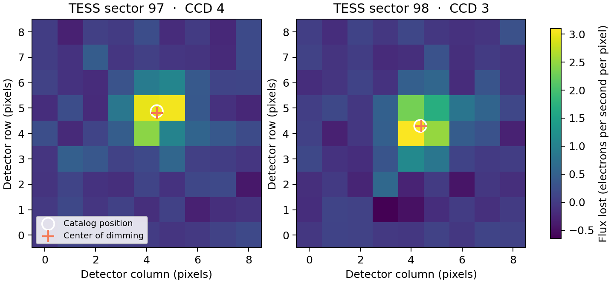

# Where the two dips occurred

Two independent 9 × 9 pixel TESSCut stamps place the dimming at the position of TIC 153838604 in sectors 97 and 98. The second event fell on a different detector. The difference-image centers lie 0.079 pixel and 0.044 pixel from the published target coordinates, respectively. At TESS resolution, an unresolved neighbor or a bound eclipsing companion could still be responsible.

| Measurement | Sector 97 | Sector 98 |
|---|---:|---:|
| TESS camera / CCD | 3 / 4 | 3 / 3 |
| In-event loss within 1.8 pixels (electrons/s) | 13.45 | 14.25 |
| Standard deviation in off-event apertures (electrons/s) | 1.00 | 1.17 |
| Largest positive off-event measurement (electrons/s) | 2.73 | 8.01 |
| Off-event windows | 101 | 116 |
| Injected-image centroid scatter in column / row (pixels) | 0.072 / 0.068 | 0.108 / 0.091 |

At each measured transit center, the in-transit image is the average over ±0.04 day. The out-of-transit image is a linear interpolation between averages at offsets of −0.20 to −0.09 day and +0.09 to +0.20 day. Only quality-zero finite exposures enter the average. A background plane is fitted to the edge pixels of the resulting difference. A two-dimensional elliptical Gaussian starts from the brightest loss pixel anywhere in the field, with the center allowed to vary across the entire cutout. Off-event windows throughout each sector establish the local scatter. Adding the observed loss image to each control gives the quoted scatter of the recovered center. These are conditional precision estimates and omit absolute WCS and point-spread-model uncertainties. [TESSCut](https://mast.stsci.edu/tesscut/) · [Archive URLs and FITS checksums](localization.json)

The nearest separate Gaia DR3 source is 49.56 arcseconds from the target and has G = 20.17. The nearest separate source brighter than G = 18 is 55.04 arcseconds away. These are measurements among resolved Gaia sources. The target has a Gaia mean radial velocity of 75.61 ± 2.03 km/s over 22 transits, with no robust velocity amplitude tabulated. A mean velocity cannot establish a companion mass. [Gaia field, 108 arcsec search radius](gaia-field.csv) · [ESA Gaia archive](https://gea.esac.esa.int/archive/)

Run `python pixels.py` with NumPy, SciPy, Astropy, Matplotlib and Requests to fetch both cutouts, measure the differences and recreate the plot. An optional directory argument selects a cache containing `s97.zip` and `s98.zip`. The two compressed arrays contain the measured loss image and all comparison images.

The constrained least-squares solver uses SciPy's default maximum of 700 objective evaluations for a seven-parameter image. A fit that fails to converge stops the program. TESSCut methodology is described by [Brasseur et al. (2019)](https://ui.adsabs.harvard.edu/abs/2019ascl.soft05007B/abstract).
