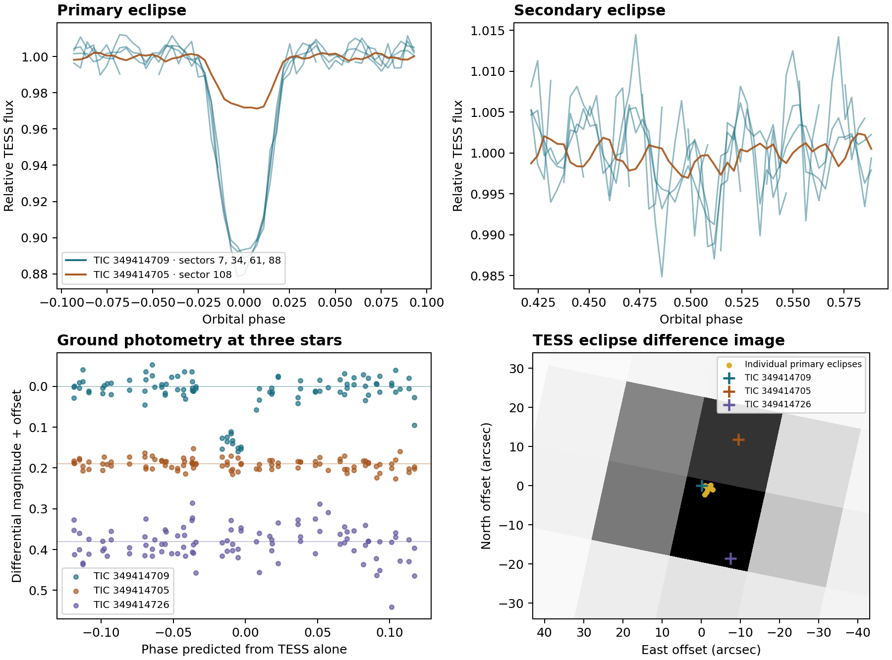

# Locating the eclipsing source near TIC 349414705

TIC 349414705 is the published target for a 2.71-day eclipsing-binary signal. The variable light comes from the position of **TIC 349414709**, about 15 arcseconds to its southeast. Ground photometry resolves these two stars. At the times predicted from TESS, TIC 349414709 loses about a tenth of its red light while TIC 349414705 changes by less than one percent. A fainter Gaia source lies within one arcsecond of TIC 349414709, so the assignment applies to that close blend. [IJspeert et al. 2024](https://doi.org/10.1051/0004-6361/202450507) · [Published catalogue](https://cdsarc.cds.unistra.fr/viz-bin/cat/J/A+A/691/A242)

The eclipse was published in 2024. The light curves distinguish the original target from the close pair near TIC 349414709. The two Gaia components in that pair remain unresolved during eclipse, and the companion mass is unknown.

[Illustrated report (PDF)](report.pdf) · [Editable LaTeX](report.tex) · [Catalog and prior-publication comparison](catalog-comparison.md)



## Independent tests

The linear ephemeris from 40 primary eclipses in TESS sectors 7, 34, 61, 88 and 108 is `BJD(TDB) = 2461293.69158 + 2.70917244 × cycle`. The timing residuals have RMS 10.2 minutes. Omitting each sector in turn gives periods from 2.70917053 to 2.70917333 days. This range measures sensitivity to sector choice. The four older TESS light curves are from apertures centered on TIC 349414709. Their median even- and odd-cycle primary depths cover 10.0–11.8%. The corresponding measurements in the brighter nominal target's sector 108 aperture are 2.76% and 2.75%. A weaker trough near phase 0.505 appears in sectors 34, 61, 88 and 108. Sector 7 gives an inconclusive secondary measurement. The similar successive primaries and shallow intervening trough support the shorter orbital period. [MIT Quick-Look Pipeline at MAST](https://archive.stsci.edu/hlsp/qlp) · [NASA TESS sector 108 threshold-crossing events](https://archive.stsci.edu/missions/tess/catalogs/tce/tess2026250113507-s0108-s0108_dvr-tcestats.csv)

Photometry from the Bochum Galactic Disk Survey spans May 2011 to May 2018. The table compares the median magnitude inside the primary eclipse to the median baseline. All three stars were measured in the same field at the same observing epochs. The periodic prediction and eclipse center use TESS alone. The ground light curves have 187 epochs in r′ and 186 in i′ per star, with 10 and 8 points in the primary windows respectively. The two filters share observing nights. [Blex et al. 2026](https://doi.org/10.1002/asna.70087) · [GAVO light-curve service](https://dc.g-vo.org/bgds/l2/ssa/info)

| Ground source | r′ flux loss | i′ flux loss | Interpretation |
|---|---:|---:|---|
| TIC 349414709 | 10.62% | 10.67% | Deep eclipse in both bands |
| TIC 349414705 | 0.16% | 0.69% | Published TESS target |
| TIC 349414726 | −0.18% | 1.64% | Additional field control |

Independently, seven sector 108 TESS primary eclipses yield a mean difference-image centroid at ICRS (114.518881°, −20.393012°). At the observing epoch this is 1.93″ from TIC 349414709 and 14.76″ from TIC 349414705. These distances use TICv8 proper motions. The typical TESS pixel spans about 21″. Agreement across individual eclipse images tests repeatability, while the independent ground photometry anchors the attribution despite possible absolute TESS astrometric bias. The NASA pipeline also measures a 15.15″ eclipse offset from the nominal target. [Sector 108 pixel product and other archive links](source-products.csv)

## Physical interpretation and prior identification

IJspeert et al. list TIC 349414705 with period 2.7084875683 days and reference primary BTJD 2232.014957084. Their catalogue also lists a doubled period of 5.4170243594 days. The corresponding measured TESS minimum occurs 2.78 minutes before their published epoch. The linear multi-sector prediction occurs 5.19 minutes before it. The present result locates this previously reported eclipse. The unvetted target list of Kostov et al. contains the nearby TIC 349414726. Its spatially resolved ground measurements are included above. The Bochum per-band source records for TIC 349414709 have variability flag zero, as does its band-matched entry. The predicted eclipse is visible in the underlying measurements. [IJspeert et al. data](https://cdsarc.cds.unistra.fr/viz-bin/cat/J/A+A/691/A242) · [Kostov et al. candidate and vetted tables](https://cdsarc.cds.unistra.fr/viz-bin/cat/J/ApJS/279/50) · [Bochum light-curve catalogue](https://dc.g-vo.org/bgds/l2/ssa/info)

The brighter member of the close blend is Gaia DR3 5715476503089307520 (G = 13.316, BP−RP = 0.879, parallax 2.227 ± 0.062 mas). TICv8 gives it radius 0.922 ± 0.054 solar radii and temperature 5701 ± 138 K, with 2MASS J/H/Ks = 12.018/11.583/11.416. Gaia DR3 5715476503077503616 is 0.9″ away and 3.31 G magnitudes fainter. Its estimated TESS magnitude, 15.99 ± 0.60, gives it about 5% of the combined TESS flux at the catalogue central values. The uncertain color and the subarcsecond separation prevent a definitive identification of the eclipsing component. The brighter star's Gaia RUWE is 5.12. The available observations provide neither dynamical masses nor a unique companion radius. [Gaia DR3](https://www.cosmos.esa.int/web/gaia/dr3) · [TESS Input Catalog](https://archive.stsci.edu/hlsp/tic) · [2MASS](https://www.ipac.caltech.edu/2mass/)

## Reproduce the measurements

The included compact files contain the five quality-zero light curves, individual primary-eclipse pixel differences, pixel coordinate grids, Bochum photometry and catalogue context. Python with NumPy, pandas, SciPy, Matplotlib and Astropy is sufficient. Execute from this directory.

```sh
python measure.py
```

The script writes the figure, four main numerical tables and a timing sensitivity table. `eclipse-times.csv` gives the timing residual for each primary. `tess-event-depths.csv` records each measured primary, secondary, and off-eclipse control. `ground-depths.csv` gives sample sizes and median contrasts in both filters. `pixel-centers.csv` includes individual eclipses, with the combined image in row zero. The magnitude comparison uses absolute phase <0.018 in eclipse and absolute phase between 0.035 and 0.43 for the baseline. All 373 distinct Bochum time stamps match same-filter observatory frames to within 0.472 seconds. The reduction converts the recorded observatory UTC times to barycentric TDB. The VOTable labels the same values barycentric TCB. The time convention and the effective midpoint of the stacked exposures affect which data fall inside the narrow phase windows. [Frame matches and timing sensitivity](timing/README.md) The comparison keeps the eclipse center fixed. The phase and width of the exploratory TESS secondary test were chosen after inspecting TESS data.

To rebuild the compact measurement inputs from all twelve source products, supply a cache directory, then run the measurement. A different destination for the three regenerated inputs can be selected with `--output DIRECTORY`. The pixel extraction compares frames within 0.023 days of each predicted primary with frames 0.070–0.115 days from center on both sides. It fits an elliptical Gaussian to the resulting difference images.

```sh
python rebuild.py archive-cache
python measure.py
```

The search examined the public TESS SPOC single-sector event tables for sectors 104–108. The field was selected for a significant displaced eclipse centroid and a nearby plausible optical source. These selection criteria favor measurable displacement, so this case gives no population frequency. NASA's TESS mission provided the spacecraft measurements, SPOC provided the sector 108 pipeline products, MIT provided the Quick-Look Pipeline light curves, and STScI distributed the data through MAST. Ground data are from the Bochum Galactic Disk Survey via GAVO. The stellar context uses the TESS Input Catalog, the Two Micron All Sky Survey, and ESA's Gaia mission data processed by the Gaia Data Processing and Analysis Consortium. The prior publications were checked through CDS VizieR. [MAST](https://archive.stsci.edu/missions-and-data/tess) · [Blex et al. 2026](https://doi.org/10.1002/asna.70087) · [CDS VizieR](https://doi.org/10.26093/cds/vizier)

## Study design and authorship

The search selected this field retrospectively from displaced TESS eclipse signals. Ground photometry tests the TESS timing prediction at three positions. The archive photometry retains its original terms and survey credits. No pre-registration was made.

OpenAI Codex agents carried out the archival search, measurements, figures and interpretation. The original observations and catalog entries are the work of the survey and network teams credited above. Build the report in this directory with `pdflatex report.tex`.

## Independent review

An independent OpenAI Codex reviewer (GPT-6 family) extracted [the study commit](https://github.com/Dolcruz/science/commit/0a37850d631ce6a5e03d2050ee94da428c1178c9) and reconstructed all 1,119 ground measurements, ten TESS light-curve arrays, seven difference images and their coordinate grids from the 12 archive products. The reviewer independently checked the published catalog epoch, the position offsets and the two-source Gaia blend. Comparing all 373 distinct Bochum epochs with their original frames exposed conflicting archive time labels. Applying the observatory-time correction changes the primary r′ depth to 10.62%. The source attribution is stable across the timing conventions tested. [Timing evidence](timing/README.md)
