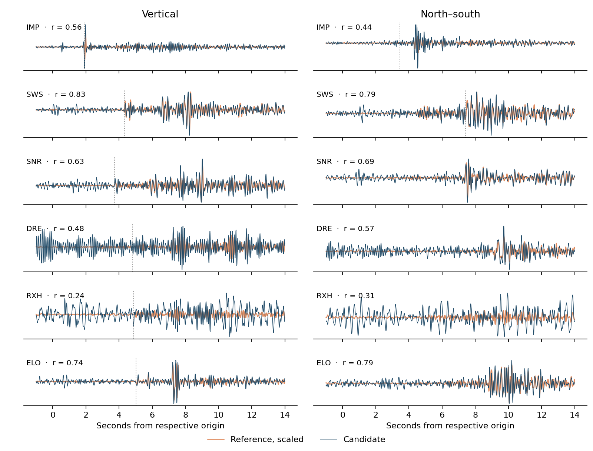

# A small earthquake during the May 2026 Brawley swarm

**A seismic event near Brawley, California, arrived at about 03:30:02 UTC on 10 May 2026.** Its waveforms repeat those of Southern California Seismic Network earthquake CI41460424 across six stations. Both compressional (P) and shear (S) arrivals appear at the times predicted by the reference event. The nearest Brawley origin in the regional catalogs examined is 74 seconds later. The observations support an additional small local earthquake during an already documented swarm. They do not identify its triggering mechanism or establish discovery priority.

The estimated magnitude of about 1.4 is relative to a cataloged event. The hypocenter and depth require a separate solution. The catalog comparison is dated 20 November 2026.

[Illustrated report (PDF)](report.pdf) · [Editable LaTeX](report.tex) · [Four additional stations and fixed-time phase tests](additional-stations/README.md)



Blue shows the candidate and orange shows the magnitude 1.96 reference, 13 minutes earlier. The orange trace is scaled by least squares for each panel. Each row uses the station's measured counts after 2–12 Hz filtering. Within a panel, the two traces share a time axis and amplitude scale. Dotted lines mark network picks of P on the vertical and, where available, S on the horizontal. The coefficients use the full native 100 Hz sample series from 1 to 13 seconds after the respective origin. Time zero uses the catalog reference origin and the candidate's detector-grid epoch.

## Detection and physical checks

The search covered 02:00–04:00 UTC. It used all 65 SCSN templates of magnitude 1.2–3.1 inside a box spanning ±0.065° in both coordinates around 32.965° N, 115.556° W, with ten seconds of margin at the start and twenty seconds at the end. Vertical ground-velocity records from CI.IMP, CI.SWS and CI.SNR were filtered at 2–12 Hz and sampled at 50 Hz. The score was the mean normalized correlation in a 12-second window starting one second after the template origin. At each time the maximum over the full template set was retained. A 0.25 score threshold and six-second minimum separation produced 240 peaks. Removing peaks within 15 seconds of any SCSN or Brawley double-difference origin left 142. Three other stations ranked these peaks by their median correlation at the same time and with the same template. [Dated origins and template selection](search-origins.csv) · [All 142 peaks](search-peaks.csv)

The highest ranking-station median was **0.661**, at **03:30:01.960 UTC** on the detector grid. The vertical discovery correlations were 0.808, 0.786 and 0.797 at IMP, SWS and SNR. The ranking correlations were 0.661, 0.293 and 0.868 at DRE, RXH and ELO. RXH has comparatively weak signal. The template's published origin at 03:16:47.510 was rounded to 47.520 on the 50 Hz grid. The lag of 794.440 seconds therefore places the candidate at 03:30:01.950 relative to the published origin. The hundredths identify samples. Absolute origin time also depends on the reference solution and the candidate's location.

One-second circular shifts test how often unrelated times on the ranking network yield agreement this strong. For each nonzero shift across the two-hour record, the three ranking-station correlation series were shifted together, preserving their mutual timing. All 142 discovery times were then re-ranked using their originally selected template. **Four of 7,199 shifted maxima** reached the observed ranking score. Two shifts produced essentially exact correlations with a template itself. The shifted samples share waveforms and include other earthquakes in the swarm. This is an empirical comparison conditional on the search and its selected peaks. [Full time-shift results](time-shifts.csv)

Short windows provide a phase-by-phase check at native sampling. The published P picks for CI41460424 predict arrivals from 1.91 to 5.02 seconds after origin across the six stations. Correlating from 0.25 seconds before to 1.15 seconds after each prediction, over trial shifts of ±0.25 seconds, gives peak correlations **0.56–0.96** at shifts **−0.02 to +0.01 seconds**. Two published S picks give horizontal correlations **0.962 at IMP and 0.903 at SWS**, at shifts of −0.02 and 0.00 seconds. The search and ranking used only vertical components. For the S test, north–south records use the arrival times picked on the east–west component by the network. DRE's published P pick is on its vertical accelerometer. The DRE comparison uses vertical ground velocity. [Reference phase picks](reference-picks.csv) · [Phase measurements](phase-comparisons.csv) · [Network reference event with arrivals](https://service.scedc.caltech.edu/fdsnws/event/1/query?eventid=41460424&includearrivals=true)

The Brawley double-difference catalog places the reference at 32.959414° N, 115.554199° W and 10.212 km depth. The routine SCSN catalog places it at 32.956° N, 115.558° W and 9.5 km. Close agreement in differential phase times places the candidate near this source. Candidate coordinates and depth have not been independently inverted. On the six north–south components, candidate-to-reference peak-to-peak ratios in the 2–12 Hz window range from 0.211 to 0.497, with median 0.285. Adding the base-10 log ratio to the reference magnitude gives a **relative size estimate of about 1.4** (station values 1.28–1.66). This is a band-limited amplitude comparison. A calibrated local magnitude would require instrument and station corrections, and noise affects the weaker records. [Component amplitudes and pre-event noise](station-measurements.csv)

## Catalog checks

| Source examined on 20 November 2026 | Nearest relevant origin |
|---|---|
| SCSN annual catalog and regional FDSN event service | CI41460496, 03:31:16.030, 74.07 s later. [SCEDC query response](sc-event.txt) |
| SCSN special Brawley double-difference catalog, 635 listed events | CI41460496, 03:31:16.050, 74.09 s later. [Released relocation catalog](https://service.scedc.caltech.edu/ftp/catalogs/SCSN_DD/Brawley_hypodd_cat) |
| Mexico's RESNOM catalog | BC60497252, 03:31:16.200, 74.24 s later. The separate 03:22 candidate produced by the detector lies within 2 s of a RESNOM event, illustrating the value of the cross-border check. [Catalog response](resnom.txt) · [CICESE swarm bulletin](https://resnom.cicese.mx/sitio/ui/img/Boletines/Reporte_Sec_20260510.pdf) |
| USGS ComCat, worldwide ±2 min | CI41460496. The other result is M1.2 near Pearsall, Texas, at 03:29:05.109. [ComCat response](comcat.json) |
| International Seismological Centre, regional ±2 min | Only the CICESE 03:31:16.200 origin, returned as ISC646161965. [ISC response](isc.txt) |
| EMSC, 02:00–04:00 regional query | 03:39:30.460, 568.50 s later. [EMSC response](emsc.txt) |

These are overlapping sources. In particular, several services carry the same SCSN or CICESE origins. The Caltech Quake Template Matching catalog covers 2008–2017, and the recent statewide machine-learning catalog described by Rong and colleagues extends through 2025. Neither covers May 2026. Unpublished detections, later catalog revisions and detections from other efforts remain possible. [SCEDC alternate catalogs](https://scedc.caltech.edu/eq-catalogs/altcatalogs.html) · [California statewide ML catalog coverage](https://central.scec.org/publication/15268)

## Reproduction

The compact archive contains 70 s of **native 100 Hz integer instrument counts** per component for each of the two events, spanning 30 s before to 40 s after the quoted origin. Each acquisition contributed two components at each of six stations. To reproduce the amplitudes, phase comparisons and figure from these cutouts, run the following in this directory.

```sh
python -m pip install numpy scipy matplotlib
python measure.py --output results
```

For the complete two-hour search, the following commands retrieve 12 daily miniSEED files totaling 176,761,856 bytes, check their SHA-256 digests, reject data gaps on the analyzed channels and interval, and reconstruct the cutouts, search peaks and time-shift controls. The commands execute sequentially. The scripts add no network timeout, automatic retry or worker pool. The reference environment used Python 3.13, NumPy 2.4.2, SciPy 1.17.1, Matplotlib 3.10.8 and pymseed 1.1.0. [Waveform source URLs and hashes](waveform-sources.csv)

```sh
python -m pip install pymseed
python survey.py --cache data --output results
python measure.py --chips results/native-cutouts.npz --output results
```

The survey reads the distributed dated catalog extract. To query the current annual and special catalogs and compare their contents with that extract, run `python catalogs.py current-origins.csv`. Live network records can change. [Source query parameters and archive identifiers](catalog-sources.csv)

Waveform and earthquake data are from the Southern California Seismic Network, operated by Caltech, USGS Pasadena and partners, and archived by the Southern California Earthquake Data Center. RESNOM data are from CICESE. The catalog comparisons also use USGS ComCat, the International Seismological Centre and the European-Mediterranean Seismological Centre. [SCSN network](https://doi.org/10.7914/SN/CI) · [SCEDC archive](https://doi.org/10.7909/C3WD3xH1) · [SCEDC cloud data](https://scedc.caltech.edu/data/cloud.html) · [RESNOM network](https://doi.org/10.7914/SN/BC)

## Study design and authorship

The template search and ranking were retrospective. Three stations detected peaks, three ranked them, and four further stations tested their predicted arrivals. The waveform extracts retain the terms of their originating data providers.

OpenAI Codex agents carried out the archival search, measurements, figures and interpretation. The original observations and catalog entries are the work of the survey and network teams credited above. Build the report in this directory with `pdflatex report.tex`.

## Independent review

An independent OpenAI Codex reviewer (GPT-6 family) extracted [the study commit](https://github.com/Dolcruz/science/commit/0a37850d631ce6a5e03d2050ee94da428c1178c9) into a fresh directory. From 12 hash-verified daily waveform files, the review reproduced all 142 eligible peaks, all 7,200 time-shift rows including the unshifted case, the native waveform cutouts and the phase tables. The 922 catalog-selection rows, eight catalog hashes and four additional stations also matched. The times and relative size support the event. Its hypocenter and absolute magnitude remain open.
